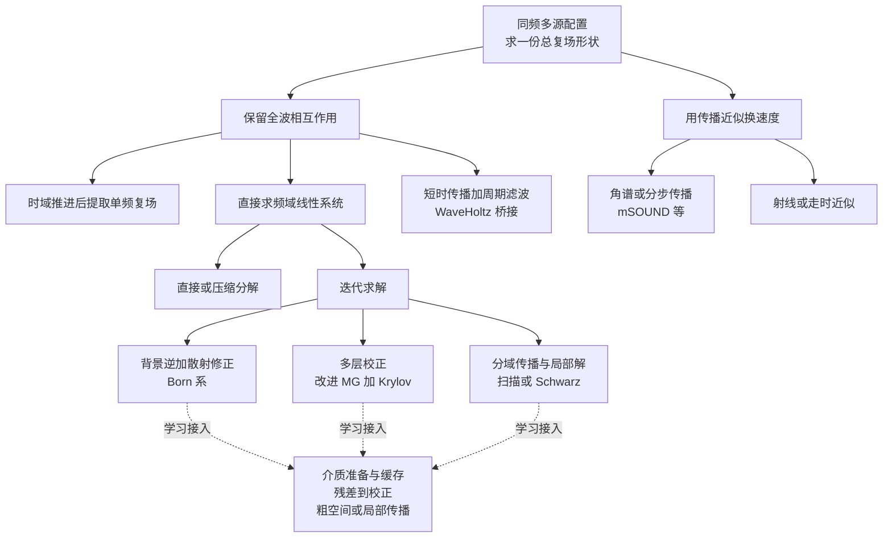
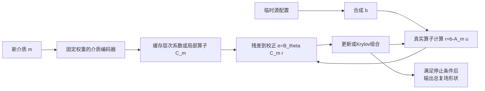

# 三维总复声场求解：传统路线、强基底与神经网络接入位置

日期：2026-10-18。状态：**本轮文献比较完成，形成有条件的路线推荐；尚无本任务的新增计算实测。**

任务依据：[MISSION](MISSION.md)。来源定位：[REFERENCES](REFERENCES.md)。检索、查重和补证据过程：[SEARCH_LOG](SEARCH_LOG.md)。

## 先给判断

**值得把研究重心放到频域全波求解及其学习加速，但应同时保留快速传播的条件性支线。**决定这个选择的是单频、完整复场、临时多源及介质复用这组要求，而不是“神经迭代看起来更有物理结构”。本轮保留以下少数路线：

| 地位 | 保留什么 | 为什么保留 | 目前最关键的条件 |
| --- | --- | --- | --- |
| 首要数值基底 | **变密度收敛 Born / universal-split 迭代**，先以自身高效实现作对照 | 已有三维声速/密度异质经颅实现；不需标签或逐介质训练，适合矩形体素域与 GPU | 强反差下迭代慢；当前完整域的真实残差、总场形状与完整时间仍需同任务比较 |
| 同等认真对待的传统竞争路线 | **面向波传播改进的多重网格 + Krylov 外迭代** | 传统方法近期有实质进步；适合把介质准备和逐次校正分离，也有明确学习位置 | 当前约 6 点/水波长，不能直接继承 10–12 点/波长论文的收敛表现 |
| 条件性高精度/容量路线 | **传播感知域分解**：选扫描预条件，或选带全局校正的 Schwarz，而非全部堆叠 | 局部因子与界面传播按介质复用；大三维有强证据，可减少全域向量或处理容量限制 | 介质准备、局部求解、通信成本更重；多独立 RHS 的吞吐优势需按本任务重算 |
| 条件性快速近似支线 | **mSOUND/扩展角谱一类单向传播** | 有近年异质颅骨全文和显著成本优势，应认真比较 | 现有平面输入、有限反射和全颅内复场形状证据不足，当前不能直接承接任意环绕点源 |

**最值得优先学习的是“介质只处理一次，残差每次快速校正”的算子，而不是每轮把整块介质和波场重新送进大网络。**McMg 是这个位置的强参考。第二优先是学习构造多层/粗空间或局部传播近似，降低准备或每步成本。普通直接 U-Net、全场初值加修正和逐题 PINN 暂不进入主候选。这里的推荐是文献比较和迁移分析，不宣布某方法已在 MIDA 胜出。[R04](REFERENCES.md#r04)、[R07–R11](REFERENCES.md#r07)、[R13](REFERENCES.md#r13)

## 1. 先看路线关系

图中的几层不能混排：

- **时域/频域**：求随时间变化的状态，还是直接求某个频率的复振幅。
- **离散方法**：用有限差分、有限元、谱方法或积分方程把连续问题变成可计算对象。频域并不等于有限差分，时域也不等于低阶差分。
- **直接/迭代求解**：得到离散方程后，怎样求解。
- **预条件、扫描、多重网格、网络**：帮助求解的计算部件或完整组合，需要交代所在位置。

因此，McMg 不能与“时域”作为同层大路线竞争；FFT 既能出现在 k-Wave，也能出现在 Born，看到 FFT 也不能认定两者做的是同一件事。此层级依据经颅共同基准各工具描述及数值框架整理。[R01](REFERENCES.md#r01)、[R02](REFERENCES.md#r02)、[R11](REFERENCES.md#r11)

## 2. 本任务怎样改变选择

### 2.1 几千个源合成一个方程右端项

把完整计算域内所有未知量排列成一个长向量 `u`；介质决定线性算子 `A_m`，临时配置决定右端项：

`b = Σ_j a_j b(s_j)`，然后解 **`A_m u = b`**。

这里 `b(s_j)` 表示第 j 个位置的源，复权重 `a_j` 包含该配置指定的幅度和相位。按线性关系，先相加源项再求解，就能得到总场。**同一次有几千个源，不意味着必须做几千次全域独立求解。**时域线性求解器也能同时注入这些源；这项优势不是频域独有。

对于有限支撑的网格点源，源项组装主要随源点数增长；全域求解规模由介质网格决定。迭代次数仍可能随合成源激发的波场模式变化，不能声称任意源配置都等时。大域数组初始化和数据传输也不是零成本。

这使“几千份单源响应预计算”“一次解数十个独立 RHS 的块方法”不再是默认解法。两者在各自任务中有价值，但本任务一次只需 1 个合成 RHS。真正可以摊销的是**同一介质下后续配置的次数 Q**。[MISSION §2](MISSION.md)、[R10 §5](REFERENCES.md#r10)

### 2.2 形状输出仍需正确的相干叠加

求解阶段保留源之间的相对幅度与相位。先把每个单源场分别归一化，会改变它们相互抵消、相互增强的结果；最后再归一化也补不回来。正确流程是：

`给定配置 → 合成源项 → 求完整域总复场 → 取颅内目标区域 → 按现有规范评价形状`。

全局幅值不是验收目标，但内部不能随意丢掉相对尺度。本文不新增 raw/绝对 Pa 验收，不给单源分别归一化后的叠加安排位置，也不拟合额外全局相位来美化比较。

### 2.3 换介质要区分三件事

1. **通用离线训练**：一次在许多介质和残差上学习规则，成本可较大，但要说明数据和适用范围。
2. **新介质准备**：生成系数、网格层次、局部因子、粗矩阵或缓存；这是用户希望较快完成的部分。
3. **新配置求解**：固定介质后，对每个新 `b` 重新求总场。

神经网络对新介质执行一次编码属于第 2 项；对这块介质再做数百或数千次梯度更新属于重新训练，不能换个名称算“瞬时预处理”。介质缓存可复用并不自动意味着换颅骨后的加速保持不变。

### 2.4 需要比较的完整成本

对同一介质上的 Q 次配置，统一写为：

`T_m(Q) = T_medium + Σ_q [T_source(q) + T_solve(q) + T_move(q) + T_output(q)]`。

学习路线另列 `T_offline_train`；若新介质还需适配，再把 `T_adapt(m)` 加进 `T_medium`。记录一次冷启动和缓存驻留后的耗时，避免把网络热推理与数值冷启动比较。

本轮不预设“必须低于多少秒或误差多少”。选择依据应是**形状误差—完整时间曲线**，以及介质准备的可接受程度。下面的文献数字提供方法能力和瓶颈证据，并非可以直接拼出的 MIDA 排行榜。

## 3. 主要传统路线的实质比较

| 路线 | 怎样得到总复场 | 固定介质复用什么 | 为何值得/不值得优先 |
| --- | --- | --- | --- |
| 时域全波：k-Wave、FDTD、时域 FEM/SEM | 同时施加源，推进到稳态，再从压力振荡提取 Re/Im | 介质系数、空间算子、边界和执行计划；新配置通常仍需推进 | 模型能力、成熟实现及参考价值强；本任务只要单频稳态，许多启动和时间推进工作不直接形成最终输出，故不优先作为新学习加速主线 |
| 频域全波：体素差分/谱或 FEM + 直接/迭代 | 固定频率直接解 `A_m u=b` | 算子、预条件层次、背景逆、局部/全局因子等 | 最贴合单频复场和介质复用；难点转移到大规模振荡不定系统的求解，强预条件是核心 |
| 周期稳态/时频桥接：WaveHoltz、相关可控性思路 | 短时受迫传播和滤波组成固定点，再迭代求稳态 | 时域空间算子和相关预条件；新 RHS 仍要多轮传播 | 能利用已有时间推进器，是严肃路线；当前没有直接覆盖本任务的优胜成本证据，先作备选 |
| 单向/分步波传播：角谱、ESSF、HAS 家族 | 沿传播方向逐平面推进，近似透射/反射和折射 | 平面间传播系数、介质切片及部分传播核 | 非常有吸引力的快速近似；本任务的任意颅外点源、全颅内域和多向反射，超出当前平面入射实现最有把握的范围 |
| 射线/走时及几何声学近似 | 估计路径、传播时间和幅相，再合成 | 介质走时/路径信息；具体复用依源位置和算法而定 | 适合路径、初相或聚焦等较低维任务；靠它单独覆盖衍射、干涉和复杂多次散射的完整复场，代价/适用性不同，当前降级 |
| 边界积分/BEM、均匀背景 Green 表示 | 通过边界未知量或体散射积分重建场 | 几何相关矩阵、核、压缩/快速多极结构 | 分片均匀和界面主导介质很有优势；若整个体内参数都随位置变化，通常要引入体积分或更多分区，不能把二维边界自由度优势直接套给当前体素异质介质 |

前两类的共同经颅比较见 [R01](REFERENCES.md#r01)，周期桥接见 [R12](REFERENCES.md#r12)，快速传播的现状见 [R06](REFERENCES.md#r06)。表中优先级属于本轮任务分析。

### 3.1 为什么暂时不把时域作为学习主基底

时域求解的优势不是弱：它能自然处理启动、宽带与传播过程，也已有完整经颅工具。但这里频率固定，用户只需要最终复振幅，**直接针对稳态方程减少重复传播更值得先研究**。

这不等于“频域一定更快”。若三维频域预条件很差，几千次全局 FFT、GMRES 正交化或分解准备完全可能抵消优势；频域也不天然更省内存。时域通常只需保留少量当前状态，而长重启 Krylov 会保留许多历史向量。时域仍应留作可靠参考和速度对照，不能先剔除再宣布频域胜出。[R02](REFERENCES.md#r02)、[R04](REFERENCES.md#r04)、[R09](REFERENCES.md#r09)

若以后任务变为宽带瞬态、多频或非线性，权重会明显改变。当前不据这些未来情形扩展物理任务。

### 3.2 快速传播为何保留支线，而未直接推荐落地

P57 的全文比此前摘要提供了更有用的信息：mSOUND 的快速传播确实值得重视，但其输入是入射平面，曲面换能器另由 FOCUS 生成该平面。它沿主要方向推进，反射通过有限阶模型处理。[R06 §II–III](REFERENCES.md#r06)

**本轮分析：**对于位于同一侧、能定义共同入射面、以透射波为主的配置，这条路线可能很有竞争力。但围绕颅顶任意摆放的点源，一般不存在一个方便的共同平面，所有源到所有颅内位置也没有共同的单向传播顺序。按多个方向分组、构造多个入射面再相加是可研究的适配工作；准备成本和组间传播误差都须计入，不能在当前报告里算成现成能力。

因此保留的是**有几何条件的快速近似候选**，而不是用一个焦域图像相似的结果替代完整复场验收。若后续测得其整个颅内形状曲线有竞争力，它可以在快速档中提升优先级；无需为了坚持迭代路线而排斥它。

## 4. 进入频域迭代后，要比较哪些完整基底

### 4.1 先理解三个计算角色

假设已有一个近似场 `u_k`，把它代回方程：

`r_k = b − A_m u_k`。

这个**残差**是尚未满足方程的部分。若能求出校正 `e_k` 满足 `A_m e_k ≈ r_k`，更新 `u_{k+1}=u_k+e_k` 就能改善解。

**预条件器**就是较便宜地给出这类校正的计算办法，记为 `e_k≈B_m r_k`；并不要求存储完整逆矩阵。**Krylov 方法**（如 GMRES）则把若干已计算的方向组合起来，使残差下降得更好。它不是替代强预条件的魔法：方向太多会增加显存、内积和通信。

对有复数边界和振荡的 Helmholtz 系统，不能因为看到“线性方程”就使用只适合正定矩阵的普通 CG，也不能把扩散方程上普通 AMG 的良好行为直接搬来。需要针对波动的预条件。[R09 §3](REFERENCES.md#r09)、[R11](REFERENCES.md#r11)

### 4.2 B1：FFT 背景逆 + 变密度 universal-split Born

**判断：优先作为贴近任务的数值底座，并作为所有学习方案必须面对的高效对照。**

它把复杂介质中的传播拆成容易计算的背景传播和介质差异引起的修正。背景逆可以用 FFT 快速作用于一个向量，再反复加入散射修正。这里迭代到收敛的 Born 系不是“只算一次散射”的弱散射近似。[R03](REFERENCES.md#r03)

P45 用压力和三个速度分量组成的系统处理变密度；物理对象比只输入声速的标量 Helmholtz 更接近当前经颅要求。它已有三维作者实现和经颅算例；每轮包含 8 次三维 FFT，反差会缩短每轮有效传播距离，拖慢全域修正。[R04 §2/§4](REFERENCES.md#r04)

完整组合应写成：

`新介质系数/背景核准备 → 合成 b → 收敛 Born 更新 → 检查原方程残差 → 总复场输出`。

| 部分 | 按介质处理 | 每个新配置处理 |
| --- | --- | --- |
| 介质/背景 | 缩放、散射系数、背景逆核、边界相关系数、FFT 计划 | 引用缓存；公开 P45 单函数接口目前会重新准备，不能把未来缓存收益当已实现 |
| 求解 | 无逐介质训练 | 源项、全部迭代、必要原残差计算 |
| 结果 | 固定输出索引等 | 总场裁取、归一化和数据移动 |

**为何本身强：**规则网格上主要是 FFT 和逐点运算，避免全域稀疏 LU；固定介质的系数可以复用，也不会因为换源就需要重新训练。

**主要不足：**强反差时仍需许多轮；四复场状态和 FFT 缓冲有代价。它的接近任务程度高，不等于已经比所有先进 MG 更快。

**最有竞争力的对照：**B2 改进多重网格；若容量成为瓶颈，再看 B3 或 P75 的拆域 Born。P75 的拆域主要解除容量上限，额外耦合会增迭代，不能提前将多 GPU 加速写成单卡收益。[R05](REFERENCES.md#r05)

**网络位置：**学习背景预条件后的残差到校正，或者学习更有效的多层校正，尽量保留真实算子检查。把 fixed-point、可负担的小重启 Krylov 和相同成本的混合方案实际比较；不预设加 FGMRES 一定更快。P46 已给出显著减迭代但输给 CBS 完整时间的例子。[R15](REFERENCES.md#r15)

### 4.3 B2：波动适配的多重网格 + 合适的外迭代

**判断：与 B1 并行理解和比较；不能拿最基础的 Jacobi-SL 代表整个传统强基底。**

多重网格用细网格消除容易局部处理的误差，再把剩余信息转到粗网格，用较少未知量做全局校正，最后传回细网格。对扩散，粗网格适合表示剩余的光滑误差；对波动，未消除的误差可能仍快速振荡，粗网格还可能把传播相位算错。因此“多几个尺度”不是充分设计。

完整传统方案至少要交代：

`离散 A → 移位/色散处理 → 平滑器 → 限制/延拓 → 粗算子与粗求解器 → 外迭代/停止规则`。

三种值得具体理解的组合如下；它们是替代配置，不要求一起叠加：

| 组合 | 真正解决的困难 | 优先程度 |
| --- | --- | --- |
| CSLP + 几何 MG + GMRES / IDR 等 | 在辅助方程加耗散，使 MG 较容易稳定；外迭代回到原方程 | 成熟实现参照。P78 已有大三维 matrix-free CPU 证据；短递推法可控制存储，但收敛行为须实际比较 |
| 较低复移位 + Jacobi/Vanka 混合平滑 + MG + GMRES | 小块联立处理比逐点更新更有效，允许较小移位，减少预条件与原问题的差异 | 应纳入强传统对照；有作者代码与三维例 |
| RS-CGC + 高阶网格转移 + 三层循环 + GMRES/FGMRES | 对齐粗细网格的数值传播相位，减少过大复移位的需求 | 很值得深入的近期方案，但现有分辨率和粗解条件与本任务有明显距离 |

第一行见 [R09](REFERENCES.md#r09)，第二行见 [R07](REFERENCES.md#r07)，第三行见 [R08](REFERENCES.md#r08)。辅助方程中的人为耗散是预条件手段，并不授权修改最终目标方程。

**最影响当前判断的限制是分辨率。**按 1500 m/s、500 kHz 和 0.5 mm 计算，水中约为 6 点/波长。P76 的主要测试是 10 点，P77 的一般收敛优势偏向 11–12 点，并有传播距离/临界规模限制。这些配置并非可以原样套用的当前强基线；“MG 本身值得严肃比较”与“该论文参数在当前网格可直接运行”必须分开。

本轮不提出把网格加密来回避这个条件。后续应在同一任务配置上比较可用的离散和预条件适配，不靠更换科学配置继承别人的迭代次数。

**介质复用：**层次结构、介质相关粗算子、块平滑系数及粗层因子可以反复使用。新介质通常需要重建这些内容；规则网格转移模板可复用，但依赖介质的谱基不必然可复用。

**网络位置：**比普通全场预测更合理的是介质条件下的限制/延拓、平滑器、粗空间或粗校正。最粗问题仍可能很大，且构造、存储和应用粗空间均有成本。P77 强调第三层能否负担地求解；只学一个“更快粗解”也必须保留足够的表示能力。[R08](REFERENCES.md#r08)、[R16](REFERENCES.md#r16)

### 4.4 B3：传播感知域分解，不把相关方法堆成套餐

**判断：保留作条件性路线，尤其适用于全域向量/FFT 存储成为障碍，或局部因子能被大量配置摊销的情形。**

域分解把整个体域分成若干小域。各小域分别解，边界交换信息，直到组合成全域一致的场。小域本身仍要求解；“只在界面迭代”不会使内部计算自动消失。

有两种应分清的完整组合：

1. **扫描预条件 + 原系统 GMRES**：提前建立局部传播/因子，再按方向传播和回传信息，近似全域块消元；用原系统迭代补回没有在一次扫描内处理好的反射。
2. **Schwarz 局部解 + 全局粗校正 + 外迭代**：局部任务更便于并行，粗空间传播跨越整个域的信息，缓解纯局部交换的慢传播。Robin、PML 传输条件和粗空间选择需明确，不能只写一个“DD”。

扫描、source transfer、polarized traces 的机制彼此相关，已知 P66 给了共同框架。扫描不等于使用单向近似作为最终答案：当扫描放在预条件位置时，外层仍求原方程。[R11](REFERENCES.md#r11)

**近期成本证据带来一个重要区分：**P79 对比了全域 ORAS 预条件和界面 OSM 系统。界面形式能省 Krylov 存储及正交化，但每次界面算子作用仍包含局部求解。原文还指出：ORAS 的局部近似主要影响收敛速度，直接把 OSM 算子内局部解替换成不准确网络则可能改变所求结果。这直接影响网络应放在哪里。[R10 §3](REFERENCES.md#r10)

**固定介质复用：**分区、局部矩阵/因子、界面传输参数、粗空间和粗矩阵。新配置仍要处理局部源贡献、所有界面迭代和最后内部回代；新介质要更新相关因子及粗信息。

**主要取舍：**因子准备可能比 Born 贵，扫描存在顺序和通信限制，颅骨强反射也可能增加迭代。P79 的批量 64 RHS 和 P81 的流水线条件不构成本轮一份总场的直接优势。我们保留它的传播和容量机制，不借用批量吞吐数字承诺在线速度。

**最有竞争力的对照：**B1 的简单 GPU FFT，及 B2 的 matrix-free 多层校正；若小局部系统的直接解已极快，网络插入反而可能得不偿失。学习界面/粗空间应先对准具体耗时，再判断是否比成熟局部分解值得。

### 4.5 为什么没有选“全域直接分解”作当前主基底

直接法提前建立因子，之后每个新 RHS 的边际成本很低，因此同一介质的大量配置下可能有竞争力。压缩分解和 GPU 实现也在发展，不能简单说直接法过时或三维绝对不可行。[R21](REFERENCES.md#r21)

但当前四千多万体素、可更换介质和较快准备的要求，使全域因子的容量、准备时间及重新分解风险突出。P79 的小三维例显示了“准备贵、后续 RHS 便宜”的取舍；作者的摊销点依赖独立 RHS 数和硬件，不能因为一个配置包含几千点源就视为立即摊回。[R10 §5.2](REFERENCES.md#r10)

因此把压缩直接法作为**高 Q、介质长期固定且资源充足时的条件性对照**。当前优先探索可快速形成介质缓存的迭代底座，学习价值也更清晰。

## 5. 文献中的数字究竟支持什么

下表的每一行只在作者自身条件下成立，**不能跨行按秒数排列赢家**。停止量按来源记录；项目最终仍评价既定颅内复场形状。论文没有单列的准备、数据移动、编译和输出成本，不自行填成 0。

| 来源 | 规模、硬件与问题 | 停止/精度口径 | 读到的时间或性能 | 对选择的作用 |
| --- | --- | --- | --- | --- |
| P45 变密度 Born | 真三维、变 c/ρ；作者 MATLAB/GPU 接口 | 原经颅以幅值/焦域为主，现有代码停止设置见旧卡片 | 有收敛曲线和每轮 8 FFT；没有当前任务可直接套用的墙钟对照 | 物理贴合度强，时间和完整复场仍需测 |
| P57 mSOUND，0.5 mm | 500 kHz、颅骨片段；EPYC 7702P CPU；两工具域不同 | 幅值/焦域比较，不是当前复形状 | FOCUS 287.77 s + 传播 36.45 s = **324.22 s**；k-Wave 3646.48 s，约 **11.25 倍**；不含通用前后处理 | 确有快速支线价值；只报 36.45 s 会漏掉主要源处理成本 |
| P27 McMg 表 2 | 224³ 地质声速体、RTX A6000；不是颅骨 | 同论文相对残差 10⁻⁶ | CBS 4.128 s / McMg 0.608 s；训练/推理约 45/6 GB | 真三维神经预条件有速度依据，迁移仍有条件 |
| P76 Vanka 表 6 | 320×320×112 Overthrust；双核 CPU，32 GB | 10 点/波长、残差 <10⁻⁶、GMRES(5) | 最快三层：Jacobi 425.34 s / 混合 409.03 s；四层为 1635.95/735.80 s | 需要和最强可用配置比；深层改进大不代表相对最快三层也大 |
| P77 RS-CGC 表 5 | 192×192×72 cells、约272万自由度；双核 CPU，32 GB | 10/12 点/波长设置，残差 <10⁻⁶ | 10 次迭代；最大例求解计时 67.25 s | 传统先进 MG 不应遗漏；与当前规模/分辨率有距离 |
| P78 CSLP-IDR(4) 表 6 | 641×641×193、约7930万未知量；DelftBlue CPU | 原方程相对残差 10⁻⁶ | 1 节点897.25 s / 6 节点203.31 s；每节点48核、192 GB | 大三维传统迭代已可行，不等于单 GPU 具有这些时间 |
| P79 OSM/ORAS | 高阶 FEM，最多约6.3亿未知量；LUMI CPU；64独立RHS | 各自相对残差10⁻⁴、complex64、restart50 | 提供局部解、正交化、稀疏运算和内存拆分；不抽成单总场秒数 | 保留界面和容量优势，避免跨任务吞吐误用 |
| P75 DD-MBS v3 | 约21.6亿体素、2×A40；标量光学及横向周期边界 | **预条件**相对残差10⁻⁶ | 2730 s、4697次迭代；与CPU单域作对照 | 支持容量扩展，不提供同GPU经颅加速比 |
| P46 NPBS 表 3 | 二维256²、H100、FP64推理 | 相对容差10⁻⁶ | CBS1124步/0.086 s；NPBS123步/0.107 s；FGMRES+NPBS37步/0.078 s | 少迭代可以更慢，也不能一概排斥Krylov |

逐行定位见 [R04–R10](REFERENCES.md#r04)、[R13](REFERENCES.md#r13)、[R15](REFERENCES.md#r15)。本轮只引用足以改变选择的数值，未从图片估造精确时间或将焦点幅值误差换算为 unit-shape L2。

## 6. 神经网络接在哪里最值得

### 6.1 第一优先：介质准备一次，残差路径尽量便宜

图只表示接入角色，不指定新网络架构。`B_theta C_m r` 表示利用缓存计算校正，不要求显式形成一个巨大矩阵。

**针对瓶颈：**固定颅骨下每次传播/迭代都在解决类似的局部介质和跨尺度耦合；若介质特征每步重算，昂贵网络会抵消迭代节省。

**输入输出：**准备阶段 `m → C_m`；在线阶段 `C_m + 复残差 r → 复校正 e`。在 B1 中也可用背景逆变换过的残差，但要使训练目标与在线坐标一致。

**训练与推理：**离线用多介质和足够丰富的残差学习校正规则，可通过方程作用构造训练目标，不必先生成每个真实点源的解。推理时冻结权重，新颅骨只生成缓存，临时源先合成，再交给同一校正器。需要训练覆盖的不仅是点源，还包括迭代途中出现的残差。

这与 McMg 的 setup/solve 分离相符；encoder–solver 是更早先例。推荐的是这个计算组织及强方法参照，不把它归为本项目原创。[R13 §3](REFERENCES.md#r13)、[R14](REFERENCES.md#r14)、[R16 §3–4](REFERENCES.md#r16)

**为什么更贴合多源：**固定介质后，真实逆作用对 `b` 是线性的。对残差保持线性、只让介质分支非线性，有利于用同一个校正器处理单源、叠加源和中间残差。无需为每个配置生成专用参数。线性结构只是合理约束，不能代替新颅骨和新配置的收敛表现。

**需要迁移什么：**P27 原系统是声速标量算子；当前物理系数和完整域不同。采用标量等价形式还是压力/速度块形式，是后续实现选择；直接复制原网络输入或照搬 0.608 s 都不成立。这里不另起物理审计，只标出会改变网络接口及代价的差别。

**怎样确认它节省总时间：**计入 `C_m` 构造、缓存容量、每轮网络、真实算子、停止检查与输出。先与 B1/B2 最强可用传统配置比，再比较固定点和小重启外迭代。不能靠把网络放到每一步、最终少了几轮就宣告成功。

### 6.2 第二优先：学习“构造校正规则”，把收益留给后续所有配置

这一位置更贴合用户的介质模块设想：**网络在换介质时帮助形成一个更好的数值工具，后续配置主要使用已生成的工具。**

两种具体对象可选择其一深入：

| 对象 | 输入/输出 | 替代或改善哪一步 | 训练与在线成本 | 当前判断 |
| --- | --- | --- | --- | --- |
| 多层/粗空间构造 | 介质块或离散局部算子 → 限制、延拓、局部振荡基/粗系数 | 代替昂贵或不合适的粗空间构造，让全局校正用较少运算完成 | 离线训练构造规则；新介质生成基后，仍需形成/解小系统和做投影 | 优先研究的第二位置；需与强传统构造比较，不能固定极小基数后期待任意高频泛化 |
| 局部预条件/传输近似 | 局部介质和边界结构 → 局部近似逆或传输参数；在线残差/边界数据 → 校正 | 降低局部分解准备、局部三角解或跨域反射误差造成的成本 | 可缓存参数，也可能每次应用小网络；须含局部反复调用和通信 | 条件性保留；以 B3 已测主耗时为前提，优先放预条件位置 |

这两个位置并非空白：P60 学延拓、P62 学界面条件、P63 比较粗解结构；P86 是需面对的传统谱粗空间思路。来源成熟程度不同：P62 主问题正定，不能拿其速度作为高频声学证据；P63 的高波数退化也提醒，仅保留源线性仍可能卡在固定基容量。[现存机制卡片](<../exploration 01/papers/README.md>)、[R16](REFERENCES.md#r16)、[R18](REFERENCES.md#r18)、[R22](REFERENCES.md#r22)

**放置位置很关键。**若用不精确网络代替预条件器内部局部解，外层还能通过真实方程纠正；若代替构成“真实界面算子”的局部解，可能是在解另一个近似系统，必须给出恢复目标系统精度的具体机制。FGMRES 也不会自动修复错误的外层算子。[R10 §3.3](REFERENCES.md#r10)

### 6.3 三个容易看起来合理、当前却不优先的位置

**一、单点源走时/相位解调。**先提取振荡相位、再求慢变部分有数值动机，Wave-ADR-NS 已提供具体方法及二维高波数实验。但它的走时依赖点源；一个合成多源场未必有单一平滑相位。若对几千源分别预测走时和求校正，成本会重新随源数增长。可以用于局部方向表示，但原方案不是本任务源无关预处理的直接答案。[R17 §3.2/§4](REFERENCES.md#r17)

**二、先预测全场，再迭代修正。**它可能有用，但应满足 `一次预测成本 < 省下的全部迭代成本`。一个幅相看上去接近的初场，也未必减少最难消除的残差分量。尚无本任务匹配的完整计时/形状证据，先不纳入主候选；不能把“初值会更好”代替计算分析。

**三、每个新问题现场训练 PINN。**把整个高频三维解写成网络并逐题优化，会把数值求解变成新的训练任务。对任意临时配置和快速介质准备，当前优先级低。这里不否定离线算子学习或物理训练，只区分计算角色。

### 6.4 直接预测有强例子，为什么仍未入选

不能把“所有直接网络都慢或没有波动结构”作为结论。P08 的 U-NO 确有真三维复位移预测，所读版 64³、多目标频率一共约 0.3 s/单 GPU，是应认真对待的证据。但它处理弹性地震场，训练数据规模大，频域误差采用另一种混合 loss，体素数与传播尺度也不同。[R19 §3–4.2](REFERENCES.md#r19)

本轮筛选结果是：尚无已核证据同时支持**当前大域、整个颅内复形状、未见介质、临时任意多源配置及有竞争力完整时间**的直接预测方案。P51/P54/P55 等局部压力幅值或峰压工作不进入这个核心对照；P44 的主前向二维切片也不提升为真三维全场证据。后续有满足条件的新证据，应允许直接路线重新入选，当前无需为它额外设计一个大网络。

### 6.5 外迭代怎样选

固定介质、固定权重且对残差严格线性的预条件器，可考虑标准 GMRES；校正器随步数变化或对残差非线性时，FGMRES 更适合容纳这种变化。对于固定点更新，经典 Born 的收敛结论不能自动传给学习替换后的更新器。

此外，FGMRES 存储更多向量，并非默认正确的最快选择。短递推法节省存储但可能有收敛波动；单独学习迭代器每步较轻，但要检查停滞/失效。P27 与 P46 分别给出外迭代有时不划算、有时划算的实例，选择应由同任务完整时间决定。[R09](REFERENCES.md#r09)、[R13](REFERENCES.md#r13)、[R15](REFERENCES.md#r15)

## 7. 换介质、反复配置和三维容量

### 7.1 各路线真正能复用什么

| 内容 | 同介质换源/权重 | 换介质 | 本轮判断 |
| --- | --- | --- | --- |
| FFT 网格、执行计划、固定背景核 | 常可复用 | 网格/频率不变时部分仍可复用；依新介质选择的背景参数须更新 | 轻准备的优势，但每轮 FFT 仍要运行 |
| Born 散射系数、介质缩放 | 可复用 | 重新形成 | 适合介质模块，公开接口是否缓存需核实 |
| MG 层次/粗算子/块平滑与粗因子 | 可复用 | 模板可能复用，介质相关数值通常需重建 | 准备可能成为重要成本，不能只报循环时间 |
| DD 局部因子/界面参数 | 可复用 | 更新局部介质相关因子；粗信息也可能更新 | 换介质快慢与子域尺度有关 |
| 通用神经权重 | 原则上复用 | 目标是冻结复用，但实际加速需跨介质证据 | “能输入新介质”与“新介质仍快”分开 |
| 介质编码/缓存 | 可复用 | 重新前向生成 | 本轮优先学习位置 |
| mini-retrain / LLPF | 完成后可摊销 | 是否需要重训由分布/尺度迁移决定 | 不是默认允许的患者预处理 |
| Krylov 回收子空间/前一配置解 | 可试用，相关配置可能受益 | 通常失效或需更新 | 可作非学习对照；不把每个任意新配置都当相近配置 |
| 源平面/某源走时/某源背景场 | 权重变化时可能可组合；位置变化须看构造 | 通常还需更新介质影响 | 不自动算“介质相关、与源无关”的缓存 |

表中的可复用性依据各算法作用关系分析，代表实现定位见 [R04–R05](REFERENCES.md#r04)、[R08–R11](REFERENCES.md#r08)、[R13–R14](REFERENCES.md#r13)。

P61 的特定介质重训练在作者二维地质设置中，按网络应用计数估算约需 270 个独立 RHS 摊回。这是反对把重训成本隐去的具体证据，不能直接预测我们需要 270 次；更不能把同次几千源当作已经完成几千次摊销。[R14 §4.4](REFERENCES.md#r14)

**准备到底多快，目前有何证据？**已读材料能确定上述更新对象，但没有给出“当前大小的未见异质颅骨、冻结权重、准备完成即服务”的统一计时。B1 主要重新生成体素系数/核，B2/B3 还可能涉及粗矩阵或局部因子，因此本轮将 B1 的准备简洁性列为结构优势；没有把它写成秒级事实。McMg 的 6 GB 推理显存也不能替代本任务缓存容量和准备时间。

离线训练的成本同样需要保留：P27 给出的三维训练显存约 45 GB，三维训练总墙钟未在本轮取作已知量；P46 附录 I 的二维 FNO 训练约 52 分钟，是另一种规模；P08 所读版三维每 epoch 约 3.7 小时、使用 8 张 A6000，且另需大量仿真标签。这些不能互相比训练效率，却足以区分“预先学规则”和“每次换介质都能免费得到规则”。[R13](REFERENCES.md#r13)、[R15](REFERENCES.md#r15)、[R19](REFERENCES.md#r19)

### 7.2 简单的摊销和学习收益判据

若方法 X 的准备比 Y 多 `ΔS`，但每配置少花 `Δt>0`，在条件稳定时，约需：

`Q > ΔS / Δt`。

这里 Q 是独立配置次数。若逐患者适配也很慢，必须一起放在 `ΔS`。没有稳定的每配置收益时，这个式子不提供摊销保证。

在线学习校正还须满足：

`传统 K0 轮的完整代价 > 学习 K1 轮的算子 + 网络 + 外迭代 + 数据移动代价`。

减少网络介质分支重算、降低正交化、避免昂贵准备和控制缓存带宽，都是实质收益来源；“少迭代”只是其中一种。此处为成本分析，不是拟合过的项目速度模型。

### 7.3 当前完整域的内存量级

以下为确定网格尺寸后的字节计算，**不是显存实测或可运行容量承诺**：

`N = 384×480×224 = 41,287,680`。

- 一个 complex64 标量全域向量：`8N` 字节，约 **0.3076 GiB**。
- 压力加三个速度分量的一个四复场状态：约 **1.2305 GiB**。
- 常见 FGMRES 实现若保存 `(m+1)` 个 V 向量与 m 个预条件后 Z 向量，共 `(2m+1)` 个状态：

| restart m | 标量状态的 V/Z | 四复场状态的 V/Z |
| --- | --- | --- |
| 4 | 2.77 GiB | 11.07 GiB |
| 8 | 5.23 GiB | 20.92 GiB |
| 20 | 12.61 GiB | 50.45 GiB |

这里还没有算介质、解/残差、FFT 工作区、多层缓存、网络中间状态和分解因子；complex128 会再翻倍。标准固定预条件 GMRES 的实现不一定保存同一组 Z，不能把这张表套到所有 Krylov 算法。

这个量级说明：选择**标量还是块状态、重启长度、是否保存全域历史、网络细层通道数**，都可能改变工程可行性。界面形式减少向量长度有意义，但其局部求解和回代必须算全；不因为界面未知量少就宣称整个问题已经低维化。

临时网络 ROI 只决定输入/输出相关处理，本轮求解仍为完整域。不以裁小物理域解决上述容量压力。

## 8. 最终推荐怎样使用

### 8.1 传统基底的优先顺序不是所有维度共用一个冠军

| 判断维度 | B1 变密度 Born | B2 改进 MG | B3 传播感知 DD |
| --- | --- | --- | --- |
| 与当前规则体素、单频经颅物理的直接接近程度 | 最优先，已有相近三维实现 | 需对当前算子/网格适配 | 需更明显的局部离散/边界组织 |
| 换介质后准备的简洁性 | 较有希望 | 中等，取决于粗空间/粗因子 | 准备更重，取决于分区/因子规模 |
| 本身的强性能证据 | 现有可行性与反差瓶颈明确 | 近期改进值得认真比较，不能只用旧SL | 大规模与内存证据强，常依赖CPU集群条件 |
| 网络接入的直接价值 | 改善强散射残差修正 | 学粗表示/算子/平滑，训练与缓存自然分离 | 学局部预条件或传输，须先明确主要成本 |
| 当前研究定位 | **首要工程参照与学习承载** | **强竞争对照和第二承载** | **有条件的第三路线** |

表中“准备简洁性”是算法结构判断，不是已经测得的新颅骨准备时间。

### 8.2 若现在只能先理解一个组合

建议从 **B1 的收敛背景逆迭代，接着看 McMg 如何把介质准备与残差校正拆开** 开始。这最容易把“真实方程在做什么、网络替换什么、每步花在哪”连起来；随后用 B2 的新传统方法检验网络究竟补上了什么。

不建议从一个大 U-Net 预测器出发，再为其补上任意修正循环。那样容易把网络开销变成主要成本，也难判断其相对强传统求解器的价值。

### 8.3 什么证据会改变排序

- 若 B2 在当前约 6 点/波长、完整介质和固定目标方程下已有非常好的总时间，B1 的首要地位应让给它；学习重点相应转到多层/粗空间。
- 若 B1 的强反差迭代成为压倒性瓶颈，而 B3 的局部准备可在用户需要的时间内完成，传播感知 DD 可提升为主承载。
- 若 mSOUND 类方法经合理的任意源接入后，完整颅内复形状达到有竞争力的快速档，它可成为独立快速路线；无需先包一个网络。
- 若冻结权重的学习校正器在新介质上需要长时间适配，其“快速换介质”的优势应撤回，再按总准备成本重新比较。
- 若可靠直接算子提供本任务匹配的精度和完整成本，应重新纳入；当前没有为排斥直接网络而设置额外门槛。

## 9. 仍会改变推荐的具体缺口，以及怎样补齐

文献调查已能作上述有条件选择。以下缺口不能靠继续泛搜同家族名称补齐，后续若进入计算阶段，应将它们写进独立实验合同：

| 缺口 | 为什么会改变决定 | 最小有效补法 |
| --- | --- | --- |
| 当前完整域的时间—形状曲线 | 论文不同网格/硬件不足以给本项目赢家 | 在同一冻结配置上比较最强可用传统 B1/B2，计入介质准备、源项、迭代、移动、输出；含不同多源干涉配置，不只单焦点 |
| 新介质准备与冻结权重泛化 | 决定是否真正满足介质模块 | 在未用于训练的新介质上分别记录纯准备、是否适配、每配置收益；不把逐介质训练藏在setup里 |
| 强 MG 在当前 6 点/波长上的表现 | 可能改变 B1/B2 排序 | 针对同一目标离散选择可运行的波动适配MG；先核粗网格表示/稳定性，不能默默加密到论文配置 |
| 学习模块在大三维域的净收益 | 网络/历史向量可能吃掉全部收益 | 记录各算子和网络的耗时/峰值存储，匹配停止规则，比较 fixed-point 与可负担的外迭代 |
| P53 的完整机制、代码与成本 | 可能改变 Born 家族内部优先实现 | 取得全文或作者公开实现后，核方程、停止条件、准备/在线成本；目前保持摘要级定位 |
| 快速传播接任意源和全复形状 | 决定支线能否进入快速档 | 先给明确输入几何和源处理算法，再在整个目标区域比较 Re/Im 形状与完整时间；不能只看焦位或网络前向 |

这些是下一步的区分性问题清单，**不是已启动实验，也不修改 V10 接口、Label 或既有运行。**无需在本轮先发明新网络，先让强传统方案与网络接入位置的选择依据完整。

## 10. 建议阅读顺序与三问对应

1. **理解任务与大路线**：本报告 §1–3；R01 的工具描述，重点读 k-Wave、JWAVE、mSOUND 各自的求解过程。
2. **建立最贴合的数值参照**：R04 旧卡片和原文 §2.2–2.3、§4；知道每次更新何时使用 FFT、为何反差拖慢。
3. **理解神经网络有价值的位置**：R13 §3.1–3.3，再读本报告 §6.1。区分权重、介质缓存、残差和校正。
4. **认真面对强传统竞争者**：R07 §5.5、R08 §3/§5.2，连同原分辨率、粗解和计时条件一起读。
5. **若容量或高精度成为主问题**：R10 §3/§5、R11 的扫描解释；先理解完整局部求解成本，再讨论学习界面。

| 任务书问题 | 本报告回答位置 |
| --- | --- |
| Q1：哪些传统大路线最适合？ | §1–3；判断在开头和§8 |
| Q2：哪些完整强迭代基底值得采用？ | §4；原文成本在§5，复用/容量在§7 |
| Q3：网络具体接在哪里？ | §6；优先顺序在§8，改变选择的缺口在§9 |

来源事实、用户已确认的任务和本轮迁移分析已分别标明。本文完成的是路线比较与证据整理；项目科学验收仍属于后续另行批准的实际验证。
