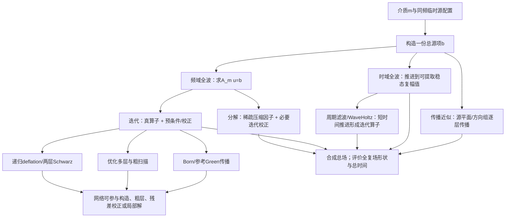

# experiment02：可更换介质、多源总复场的求解路线比较

日期：2026-10-19（调研始于10-18）。性质：**文献与作者实现的比较报告**。本次重写补入强传统基底、成本推导、实现核查和反例，替代首轮的过早排序。文献数值、已有本地实验、本轮分析分别标明；本轮没有启动求解、训练或服务器任务。

## 0. 先给判断

**主方向应保留“真实方程控制的频域迭代”，但不能把它简化为“Born优先”。**当前值得深入采用和比较的是三个完整基底：变密度Born固定点、优化两网格配粗层双向扫描、递归多层deflation配CSLP。第三者已有作者后续大三维实现证据。压缩多前沿分解作为大内存、较多配置复用时的第四个条件候选。它们的优先性来自不同成本结构，尚无同一MIDA任务上的速度冠军。[R04](REFERENCES.md#r04)、[R24–R25](REFERENCES.md#r24)

**若目标是开展学习加速研究，优先位置是强基底中昂贵的全局/粗层校正及其传播表示；其次是按介质生成这类校正的构造规则。**“介质编码可以缓存”只是应有的工程安排。真正要赢的是优化粗算子、递归粗解、扫描、谱粗空间或压缩因子所完成的工作。全细域重网络、纯局部网络和直接体场预测均不宜自动成为第一方案。[R13–R16](REFERENCES.md#r13)、[R28](REFERENCES.md#r28)、[R30](REFERENCES.md#r30)

**快速近似与时域路线保留各自位置。**mSOUND/HAS是有价值的波传播近似，包含衍射、折射及一定反射处理；不能与射线一并排除。其关键迁移代价是把环绕颅骨的临时源配置变成可传播的复平面/方向组，并保证整个体场的相干叠加。优化GPU时域则应作为可信且成熟的全波对照；单频只提供频域的动机，不保证频域总时间更低。[R02](REFERENCES.md#r02)、[R06](REFERENCES.md#r06)、[R27](REFERENCES.md#r27)、[R29](REFERENCES.md#r29)

| 当前目的/使用情况 | 应先采用的理解和比较顺序 | 决定因素 |
| --- | --- | --- |
| 较快换介质、每介质少量配置、有限GPU内存 | Born工程参照与matrix-free强多层路线并行比较 | Born步数是否很大；多层构造是否轻；细算子和相位精度是否一致 |
| 同一介质有较多配置 | 强多层/扫描与压缩分解都保留 | 每次在线收益能否覆盖准备和存储；Q是配置次数 |
| 容许较大近似误差、源有共同主要方向 | mSOUND/ESSF或HAS快速支线 | 输入平面、方向覆盖、反射阶数和全复场误差 |
| 要选学习课题 | 粗层/全局校正优先，学习构造次之，局部/界面条件性保留 | 相对强非学习替代是否节省完整时间；未见介质能否冻结权重使用 |

这是一组有依据的取舍，未强行选唯一算法，也没有把未训练网络写成结果。具体实现组合见§3，完整成本见§4–5，学习位置和换介质证据见§7–8。

## 1. 本轮到底求什么

### 1.1 一次配置只求一份总场

用户给出介质m、同一频率及临时源配置：位置s_j和复权重a_j。复数同时保存振幅和相位，可看成每个格点有Re、Im两个数。在线性传播条件下：

\[
b=\sum_{j=1}^{K}a_j b(s_j),\qquad A_m u=b.
\]

K可以是几千；可选位置不被限制为几千个。**先把源项相加，然后解一次方程**。这与分别求K个源场、保存场库、每次查询库中响应不同。后者只有在额外权衡后才可能采用，不是本轮默认任务。

固定频率和介质时A_m不随源配置改变；改变位置或权重主要改变b。这正是传统分解、粗空间、传播核和学习介质特征都能复用的原因。源配置改变后，旧解/旧Krylov子空间可作为可选加速，但其效果依赖配置相似性，不能列为必有收益。

### 1.2 形状输出保留什么

完整求解域为384×480×224 @0.5mm，共41,287,680格点；临时网络ROI为352×352×192。ROI只用于输出/评价，不能据此裁小传播介质。以1500m/s水中500kHz作参考，波长约3mm、每波长6点，最长240mm约80个波长；这解释了长程相位的重要性。骨内更高声速对应更长波长，界面几何/反射的采样困难仍须单独考虑。内部必须保留各源贡献的相对幅度和相位，最后对总场联合归一化评价Re/Im形状；不使用raw/绝对Pa验收。[任务书](MISSION.md)

将单源场各自归一化再相加，会改变真实干涉。即使每个单源近似都较好，抵消明显的配置也可能放大总场相对误差。以误差δu_j为例：

\[
\frac{\|\sum_j a_j\delta u_j\|}{\|\sum_j a_j u_j\|}
\leq \frac{\sum_j |a_j|\|u_j\|}{\|\sum_j a_j u_j\|}
\max_j\frac{\|\delta u_j\|}{\|u_j\|}.
\]

这是线性叠加的误差上界，不是当前配置的实测误差。它说明单波束焦位/幅值精度不能直接代替临时总复场的形状精度；同样要求适用于传统近似和神经网络。

### 1.3 四种“强”分别判断

1. **物理/离散接近**：是否方便处理本任务的密度、损耗、边界和点源。
2. **数值能力**：是否能在大三维、高频、强异质条件下高效解方程。
3. **工程成熟度**：是否有可核源码，准备和显存是否合适。
4. **学习价值**：仍有哪些昂贵且可由数据压缩的计算。

Born在第一项比较接近，不自动赢第二项；大规模CPU方法第二项很强，也不自动是单GPU现成实现。以下全部路线按这四项评估，避免只对某类方法要求完整任务匹配。

## 2. 主要路线的关系和去留

**离散方法和求解方法分开。**有限差分、谱方法、有限元决定如何把PDE写成A_m；GMRES、Born、MG和分解决定如何求解。不同A之间即使都把残差降到1e-6，也未必得到相同的相位精度。普通FD每波长6点的困难不能推给所有高阶/优化离散；反过来，优化粗网格3点也不是允许最终场用3点网格。[R07–R09](REFERENCES.md#r07)、[R24](REFERENCES.md#r24)

| 大路线与具体强参照 | 主要成本与复用 | 对本任务的判断 |
| --- | --- | --- |
| k-Wave C++/CUDA等时域全波 | 系数、FFT计划可复用；每个新配置仍推进很多时间步；稳定后提复幅值 | 保留全波参照。源天然可相加；体时间序列输出不是必需，但实现要提供合适的复幅值积累 |
| 频域迭代：Born、优化MG/扫描、deflation | 每介质准备算子/层级；每配置迭代；误差由真方程继续修正 | 本轮主比较。单频和配置复用有利，强异质及近共振使步数和粗解成为核心 |
| 压缩多前沿分解 | 排序、近似因子构造昂贵；后续配置复用；仍可能用GMRES补压缩误差 | 大内存/较多Q时保留；高频butterfly不能按普通LU排除 |
| mSOUND/ESSF、HAS | 横向平面FFT和介质相移；有限反射；输入平面/方向处理可能主导 | 快速档保留；复杂入射几何及相干全体场是具体适配成本 |
| WaveHoltz/周期稳态 | 多次短波传播、滤波和外迭代；可沿用时域并行内核 | 条件性保留。已有真三维能力；没有自动消除近共振，也不是一次短传播就求完 |
| 射线/走时近似 | 传播路径与相位近似很便宜 | 可作快速相位信息或预条件辅助；单靠走时不能满足完整衍射、散射复场输出 |
| 表面积分/体积分 | 均匀背景Green可利用；体异质仍须表示；体输出需重建 | 不是“降到表面就免费”。Born属于利用背景Green的一支；不额外堆成独立冠军 |

经颅工具benchmark提供共同背景，但常用焦位、幅值等指标、不同实际求解网格；不从其共同0.5mm对比网格推断所有工具都在同网格解同一个A。[R01](REFERENCES.md#r01)

## 3. 少数完整强基底：每一步到底做什么

下面C1–C4是**互相竞争的完整组合**。C2的扫描粗逆和C3的递归deflation是两种替代组织，不把它们与所有网络/Schwarz继续堆在一起。迁移到本项目的描述是本轮分析，不代表已经实现。A★表示比较时统一指定的目标细网格算子；本轮没有替项目选择或改动它。残差r=b−Au是把当前解代回方程后的差，校正z用来减少这个差；预条件器是让校正更有效的辅助计算。

### 3.1 C1：变密度一阶Born/Universal Split固定点

**来源组合**：声压及三个速度组成四复场状态φ；谱导数构成原方程A_B；均匀参考部分用FFT逆，介质反差与边界项留在散射项。一次固定点修正等价于对原方程残差施加预条件，不是只算一次弱散射Born近似。[R04](REFERENCES.md#r04)

- 新介质准备：物理系数、交错密度、边界/扩展域、缩放与shift、参考传播核；FFT计划只在尺寸/设备改变时需重建。
- 新配置：稀疏复源相加、映射到四状态右端，零初值或可选旧解；执行固定点更新。
- 在线核心：每步8次三维FFT及逐点组合，工作在完整域；普通更新不必再显式计算一次真实残差。
- 停止：原作者在检查间隔上另算残差并可加场变化条件；移植的统一比较应在固定检查点计算原方程的右端归一化残差，停止阈值不是自动照抄同一个数字。
- 结束：重标度、提声压、输出ROI及总场归一化；作者代码仍会构造速度输出并gather，必须计入或明确采用了等价的按需输出优化。

**强项**是低准备、规整FFT、大异质物理输入和任意右端。**困难**是对比度使保守缩放/参考传播的有效传播变慢，大域往往需要很多步；四状态会放大Krylov历史和工作数组。DD-Born能扩容量，但拆域增加缩放保守性、耦合和迭代，不能当免费加速。[R03–R05](REFERENCES.md#r03)

作者单函数接口把准备与求解放在一起；复用Context是合理工程拆分，传统方法同样可以做。若加入Anderson或FGMRES，应把它视为另一实现分支并计历史、正交化和额外算子作用；不默认“加外迭代一定更快”。源码定位见[C01–C02](REFERENCES.md#code-audit)。

### 3.2 C2：相位匹配两网格 + 粗层双向PML扫描 + GMRES

这里的**粗网格**是把各方向网格间距增大，让一次较便宜的计算改正跨越大范围的误差。声波在粗细网格上若走出不同相位，粗校正会失效；优化粗算子专门对齐两者的传播关系。

**来源完整组合**：细层Helmholtz、加权Jacobi前后平滑、限制/延拓、优化粗Helmholtz；粗层不做一次巨大精确LU，使用沿两方向传播的PML子域扫描，局部矩阵先用MUMPS分解，外层GMRES纠正整个误差。IOFD版三维盐丘采用细层6点/波长、粗层约3点，ν=3、Jacobi权重0.65。[R24/P87–P88](REFERENCES.md#r24)、[R25](REFERENCES.md#r25)

**需要复用的介质对象**是粗系数、P/R、子域划分、人工PML与局部因子；每个新配置仍做细层平滑、粗残差、双向局部三角解/通信、延拓与外迭代。源从哪个方向发射不要求只扫一次，双向扫描和外迭代处理回传。

**迁移判断**：这比“基础CSLP+Jacobi”更有代表性，是当前6点附近不能漏的强竞争者。优化细算子的平滑介质精度不直接覆盖颅骨跳变；保留当前目标细算子A★时，只把优化粗算子/扫描放预条件器，并重新匹配其传播关系。若A★采用谱作用，则每个外步的谱成本仍在，不能声称整个方法都是O(N)局部运算。

**具体风险**：第一次二倍三维粗化后仍约516万格点；局部因子及PML重复存储不小，扫描存在依赖链。薄PML、错误粗化边界和过度并行partial sweep都有原文反例。其复杂性是真成本，但不是排除理由；它通过每步较强的传播减少重复全域工作。

### 3.3 C3：递归高阶deflation + CSLP + 灵活GMRES

**deflation的作用**是把难以消除的误差分到由Z张成的较小空间。令E=ZᵀAZ、Q=ZE⁻¹Zᵀ，校正的一种组织为：

\[
t\approx Qr,\qquad z\approx M^{-1}(r-At)+\gamma t.
\]

M是加阻尼的移位Laplacian；γ是粗校正权重。E自身仍难解，就递归使用相同结构，外层FGMRES容许内层近似精度变化。**此处“少外步”不能省略E⁻¹和M⁻¹的实际工作。**[R24/P89–P90](REFERENCES.md#r24)

完整的强配置应跟随已核版本：高阶Bezier型传递；细两层用一轮MG近似CSLP逆（shift约0.5），较粗层用Krylov；第二层给相对内容差，其余粗层只做少数/一次递归迭代。JSC最终二维配置L2容差0.3；作者DD29三维版本采用0.1并引入γ，不能混成同一个配置或声称参数无须选择。

新介质刷新各层系数/阻尼和必要预条件对象；固定几何的传递模板可复用。每配置更新所有层残差、内迭代和外正交化。作者三维高阶传递用5³模板，深粗层模板可到7³；格点变少不等于每点工作不变。matrix-free是不显式存整矩阵，**不是不存系数、Krylov向量或粗层状态**。

补查到的三维作者报告含约7930万至数亿未知量的盐丘及更大地质模型；因此C3有资格作为大三维强基底。公开论文/报告仍没有覆盖当前完整变密度经颅物理、PML及GPU同口径性能，源码可得性也弱于C1和STRUMPACK。这里按工程适配计代价，不将其数值能力降级为“只有二维”。

**C2与C3已有可作的条件选择：**若每介质准备必须轻、存储受限，优先研究C3的matrix-free层级，避开大量局部数值因子；若重点是当前6点附近的粗细相位匹配、同一介质可复用局部因子，则C2的直接证据更接近。C2要付扫描依赖链和因子成本，C3要付高阶模板、嵌套迭代及正交化成本。这个选择来自结构与原文，未假装两者已有同硬件MIDA测速。

### 3.4 C4：HOD-BF压缩多前沿分解 + GMRES校正

稀疏A消元后会出现大而稠密的中间块。普通低秩压缩面对高频振荡可能秩增长很快；butterfly利用不同尺度的互补低秩结构压缩这些块，不能与普通BLR/HSS混称。[R24/P91](REFERENCES.md#r24)

完整过程是：组装稀疏A→排序/符号分析→近似因子构造→以因子作预条件的GMRES→真方程检查/体场输出。更严格压缩可降低后续迭代，也会增加准备和存储；§5给出实际摊销。

固定介质、频率、网格和边界时复用数值因子；换源只换b。换介质即使稀疏模式不变，通常也要更新数值因子；可复用排序不等于复用全部求解准备。若目标A★是稠密作用的谱算子，不能直接把论文的27点稀疏矩阵当作A★；可考虑用稀疏代理因子预条件A★，但真实算子作用和外迭代必须保留并另计。

**判断**：不能按渐近复杂度排除，也不能按O(N)存储推断单卡可用。论文中约1500万–2100万未知量的因子仍有数百GB；较多Q和足够内存时才是有力工程选项。P85的GPU-BLR不是P91的CPU-HODBF，不能拼接两者速度与复杂度。[R21](REFERENCES.md#r21)、[C03](REFERENCES.md#code-audit)

### 3.5 为什么两层ORAS没有再列成第五个主方案

它是强对照：局部带阻抗/优化传输的矩阵分解 + 重叠加权合成 + 网格/DtN/谱粗空间 + FGMRES。局部因子和粗基按介质复用，跨域传播靠粗问题/迭代；与扫描的串行传播组织不同。[R10](REFERENCES.md#r10)、[R30](REFERENCES.md#r30)

本轮把它放在C2/C3及学习界面位置的竞争表，而不同时推荐全部DD变种。真实三维比较显示：选很少谱向量时收敛可能慢，选很多时粗问题与构造很贵；增大重叠也未必改善总效果。若未来需要许多并行子域或已有成熟HPDDM平台，它可以替代C2/C3进入主比较。不是因为缺少本项目现成代码而断言其算法弱。

| 候选 | 真算子在哪里 | 主要近似在哪里 | 实际必须付出的代价 |
| --- | --- | --- | --- |
| C1 | 原四状态方程/检查点 | 参考逆/固定点传播 | 8 FFT×步数；额外残差检查；四状态 |
| C2 | 细层A★与外迭代 | 优化粗算子、扫描粗逆 | 局部因子准备、三角解、两方向依赖链 |
| C3 | 各层A及最外层A★ | CSLP逆和递归粗解 | 多层内迭代、粗系数/边界和Krylov状态 |
| C4 | 原稀疏A或外层A★ | 压缩数值因子 | 排序/分解大准备、因子内存和在线校正 |
| 两层ORAS对照 | 原细层A★ | 局部求解/粗校正 | 局部因子、重叠通信、特征求解及全局粗问题 |

预条件器中近似局部解主要改变收敛速度；若OSM界面“真算子”本身含局部解，随意用不精确局部解会改变该算子。学习模块不能因为“外面有GMRES”就任意放置。[R10](REFERENCES.md#r10)

## 4. 统一成本：从源配置到总复场

### 4.1 完整账目与复用范围

对固定介质的Q个临时配置，使用：

\[
T(Q)=T_{\rm train}^{\rm amort}+S_m+
\sum_{q=1}^{Q}\{T_b+T_{\rm transfer}+T_{\rm solve}+T_{\rm stop}+T_{\rm output}\}_q.
\]

T_train是通用训练成本的单独摊销记录，S_m是每次换介质的准备，含必要适配/数据生成时须拆出。在线包含源构造、设备移动、全部算子/网络/内迭代、停止检查、裁切及复场输出。不能只比较神经网络前向和另一路的整个流程。

| 成本项 | 直接格点源的全波路线 | 平面/波束传播近似 | 复用条件 |
| --- | --- | --- | --- |
| 源构造T_b | K点累加O(K)；若需清零稠密数组还有O(N)；插值会增加固定邻点数 | 可能先求复输入平面，朴素K×平面点数；再分方向传播 | 位置/权重变化后应重算相关源项，不能拿介质缓存替代 |
| 介质准备S_m | Born系数/核；MG/deflation层级；扫描/ORAS局部因子；C4数值因子 | 各平面介质项、参考速度传播核、方向重采样 | 固定介质/频率/网格/边界有效；变化后按依赖失效 |
| 迭代主体 | 真A作用、预条件、网络、内层迭代、正交化与通信 | 逐层传播和有限反射/多方向合成 | 不能跨配置复用未知新解 |
| 停止与输出 | 真残差检查；提压力；归一化；设备到主机；写一份ROI复场 | 同样要合成后归一化/输出；近似无需追逐不存在的精确残差 | 输出体量随格点增长，不能无限压成“一个标量” |

K=几千不使C1–C4的全域求解自动乘K。只有采用逐源求解库，或某个输入构造本身逐源传播时，才会出现那种成本。任意源也不强迫采用每源一个网络前向。

### 4.2 同一规模下的结构工作量

令F_N为一次当前完整网格上的三维FFT成本，A_N为一次目标细算子作用，J_N为一次局部平滑，O_m为一次Krylov正交化/归约成本。它们是成本单位，**不是假定不同硬件耗时相同**。

| 完整组合 | 每配置主体的结构表达 | 目前有依据的步数范围及局限 |
| --- | --- | --- |
| C1 | n_B(8F_N+逐点运算)+n_check·8F_N；再加输出 | 原文/具体介质可从数百到数千；本地曾到1万上限。不能借其他标量CBS步数填四状态n_B |
| C2 | n_2[A_N+6J_N+P/R+双向粗扫描+O_m] | IOFD三维盐丘12–15外步；边界、反射、细离散不同会改变它。粗扫描不是一次廉价矩阵乘 |
| C3 | n_3[A_N+递归粗解+细两层MG-CSLP+O_m] | 大三维作者报告约十几至几十外步；内层数和γ随配置改变，不能只取n_3 |
| C4 | n_4[A_N+压缩因子作用+O_m] | 已核P91异质例3–63步，随压缩容差改变；前提是大因子已构造并放得下 |
| 全域时域 | N_t·每时间步算子 + 稳态复幅值累积 | N_t随传播/稳态时间及稳定步长变化，不能拿“一个周期”代替到稳态 |

上述n不是当前MIDA的预测区间，而是说明机制和敏感性的原文实例。真正影响排名的是“少做多少昂贵工作”，不是给外迭代个数排队。

### 4.3 能直接算出的容量下界

以下仅为给定尺寸的字节/运算推导；尚未加作者实现的padding、边界扩展、FFT工作区、复制、碎片和临时数组。

| 对象及明确假设 | 数量/容量 | 影响 |
| --- | ---: | --- |
| 全域一个complex64向量 | 0.307617 GiB | 所有全体场方法都要承受的基本尺度 |
| 四个complex64状态 | 1.230469 GiB | C1历史/残差以四状态整体计算时放大4倍 |
| ROI一份complex64输出 | 0.177246 GiB | 仍约190MB；如只写有效mask会变小，但需计索引/压缩 |
| FGMRES(m=8)，只计V/Z共17个向量 | 标量5.229492 GiB；四状态20.917969 GiB | 还未计当前解、右端、预条件及FFT工作区 |
| FGMRES(m=20)，共41个V/Z向量 | 标量12.612305 GiB；四状态50.449219 GiB | 四状态长restart不能默认驻留单32/48GiB卡 |
| 三维二倍粗化第一层 | 192×240×112=5,160,960 | “只学粗层”也可能仍很大 |
| 全层几何级数，每方向减半 | 总格点<8N/7 | 不含PML保留法向或多通道扩张 |
| 27点CSR：complex64值、32bit列号/行指针 | 约12.612305 GiB，仅原矩阵 | matrix-free节省的是这一类显式矩阵，不含向量/系数 |
| 每层20实通道，两组FP32介质缓存a/s | 约7.03125 GiB | 若复特征则加倍；尚无残差/校正激活。不能只报模型权重大小 |
| 一次全细域20→20通道3³卷积 | 4.459×10¹¹ MAC | 一次乘加计一个MAC；实际总运算还要乘层/平滑次数 |

多通道若从第一次三维下采样之后才开始，其同型缓存降为上述约1/8；但这改变传播表示，能否处理未解析相位需要算法支撑，不能作为无损省内存承诺。普通GMRES与FGMRES的向量策略、低精度、卸载、restart都有可选择空间；卸载会增加传输，减少restart也会影响迭代。

**因此网络接入位置的一个实际优势是减少细域高通道工作，而不是单纯减少网络参数。**本任务的输出本来就大，逐源场库还会使ROI存储随库大小线性增长：1000份此ROI约177GiB；这不是本轮默认解法。

## 5. 用作者数据算准备与复用的取舍

### 5.1 原始计时的可比较范围

| 原文/实现 | 已核计时对象 | 可以得出的判断 | 不作的外推 |
| --- | --- | --- | --- |
| C2 Stolk两网格扫描 | 约13M三维、32CPU核、单右端：准备49 s+在线22 s | 同一介质首次至少约71 s，后续才复用局部因子 | 不把22 s称换介质总时间；不外推本GPU |
| C3 JCP2022 | 约177万三维sine，V/W为49/28步，1259/1360 s；含粗矩阵构造 | 少步但更重的W-cycle可更慢 | 不用外步数代替成本 |
| C3作者DD29后续 | 129³：CSLP76 s/85步，三层225 s/12步；513³：62716 s/343步对24681 s/12步 | 额外粗层工作有规模门槛；强基底内部也须择配 | 报告未给完整独立计时合同，不与ETNA或GPU秒数拼榜 |
| P76 Vanka | 同一三维例：三层Jacobi425 s，Jacobi+Vanka409 s；深层时改善较大 | 应与最快浅层对照，避免只挑差的深层基线 | 不把深层倍数当对最强MG的倍数 |
| P57 mSOUND | 0.5mm、CPU：FOCUS287.77+mSOUND36.45=324.22 s，对k-Wave3646.48 s | 输入平面约占其组合时间89%，算法传播变快不等于总时间百倍 | 不与k-Wave CUDA比较，不移作全复场精度 |
| P96 implicit网络 | 4096²编码0.052 s，每FGMRES步0.114 s | 同介质编码可摊销；仍需乘步数，加初值/真算子等 | 不是完整求解0.114 s，也不是三维速度 |

来源和硬件细节见[R07](REFERENCES.md#r07)、[R24–R25](REFERENCES.md#r24)、[R06](REFERENCES.md#r06)、[R28](REFERENCES.md#r28)。P88的约50M、45s/右端是四右端总179s的批处理；本任务不能默认拥有同样吞吐。

### 5.2 压缩精度的真实摊销例

P91表3在同一21.18M异质网格、32节点上，使用相同75K切换门槛：

| HOD-BF压缩容差 | 分解S（s） | 每右端GMRES求解t（s） | 因子存储（GB） |
| --- | ---: | ---: | ---: |
| 1e-3 | 674 | 52.8 | 770 |
| 1e-4 | 1049 | 11.0 | 800 |
| 1e-6 | 1657 | 4.1 | 870 |

这里的1e-3等是**压缩误差参数**，不是最终真残差阈值。表内求解停止采用预条件残差，若用于本任务还须统一最终检查。[R24/P91](REFERENCES.md#r24)

仅比较该表明确覆盖的“分解+在线”部分，算T=S+Qt：

- 从1e-3改1e-4，多花375s，单配置省41.8s，Q≥9时后者更省时。
- 从1e-4改1e-6，多花608s，单配置省6.9s，Q≥89时后者更省时，同时多占70GB因子存储。
- Q=1时三者为726.8/1060.0/1661.1s；Q=10时1202/1159/1698s；Q=100时5954/2149/2067s。最优压缩程度确实随复用次数改变。

这个计算不是完整应用耗时；源构造、排序、输入输出等未由该表单列，不能填零。它也只用于同文可控比较。另一方面，同表精确LU为分解660s、在线0.9s、因子1970GB；**若内存足够，此算例的精确LU比这些压缩方案都快**。压缩的实质价值主要是容量与更大问题可解性，不能笼统宣传“压缩必然加速”。

表2的均匀250³例则不同：精确LU513+0.72Q、HOD-BF433+3.5Q；后者在Q≤28时省分解—求解时间，Q≥29则精确LU更快，前提仍是两种内存都能容纳。跨介质排名不能脱离问题和Q。

### 5.3 学习加速的净收益门槛

设强非学习方案每配置主体时间t_0，学习方案t_N，新增每介质准备/适配ΔS，则：

\[
Q(t_0-t_N)>\Delta S
\]

才会在该介质上收回准备；通用训练另行摊销。若t_N≥t_0，再多Q也救不了在线劣势。网络每步更贵时还需满足：

\[
\frac{n_0}{n_N}>
\frac{t_{A}+t_{P,N}+t_{\rm Krylov,N}}
{t_{A}+t_{P,0}+t_{\rm Krylov,0}},
\]

并加上实际残差检查/数据移动差异。分母应是§3的强配置，而非故意弱化的MG。

已有正反证据很清楚：McMg论文的三维284→6.3步，4.128→0.608s；NPBS某MgNO分支1124→123步，却0.086→0.107s；McMg二维再加GMRES从8.4降至7.2步，0.036却升至0.059s。它们分别支持“可以有在线收益”和“少步不够”。这些是作者报告的求解计时，未逐项公布全部源处理、缓存冷启动和体输出，不能称本任务端到端收益，也不能给C2/C3代填。[R13](REFERENCES.md#r13)、[R15](REFERENCES.md#r15)

### 5.4 训练与适配不是免费准备

NPBS附录I的FNO训练约52min39s；McMg表1的二维训练21.04s/epoch、400epoch乘积约2.34h，均不含可自行假设为零的数据准备；这个二维时间不外推到其三维训练。McMg三维只明确给出约45GB训练/6GB推理存储等条件，未单列可用于当前任务的完整训练及新介质setup计时。P96最多250epoch、OOD适配另做300对/30epoch；不能以“mini”一词把它当瞬时编码。通用训练若服务很多介质可以另行摊销；每介质重训则进入S_m，并与快速换介质目标正面比较。[R13–R15](REFERENCES.md#r13)、[R28](REFERENCES.md#r28)

## 6. 时域、WaveHoltz和快速传播重新比较

### 6.1 GPU时域应如何公平保留

k-Wave官方已有优化C++/CUDA；高阶质量集块有限元的FEniCSx-FUS也通过局部sum-factorisation、显式RK4及GPU直接通信减少全局FFT/CPU往返。它们有现实并行能力，不能用慢MATLAB或CPU时间代表最强时域。[官方GPU入口](https://www.k-wave.org/documentation/example_cpp_running_simulations.php)、[R29](REFERENCES.md#r29)

时域每个新配置通常仍要等待波传播和暂态衰减。一个**结构敏感性例**：当前网格几何对角约0.327m；若参考传播速度1500m/s，跨此距离约218μs，即500kHz约109周期。若假设c_max=3000m/s、CFL=0.3，则Δt约50ns，跨域对应约4360步。这里的声速/CFL是假设例，实际等待不必等于整条对角传播时间，稳态也可能更久，不能当当前run步数。

读取k-Wave MATLAB公式可数得：线性、无额外源修正时，每步压力梯度1次FFT+3次逆FFT，三速度散度再3+3；吸收等项还会增加变换。CUDA可优化融合、实变换和复用，不能按变换次数给精确秒数。但这个结构说明单频稳态的重复推进是实在成本；C1若也要数千步，频域未必赢。[固定代码公式](https://github.com/ucl-bug/k-wave/blob/94e558318b4ab7c583b63c50b7e9b574556dc159/k-Wave/kspaceFirstOrder3D.m#L767)

**体场输出也要公平**：只存若干周期时间序列会增加I/O；在线对指定频率积累Re/Im可把存储降到体场级，但是否已有该输出入口、是否有GPU—CPU逐步拷贝要按实现核查。本次读取了支持压缩输出的k-Wave衍生CUDA实现，未把它冒称官方版本或既成的本任务复幅值接口。[C08](REFERENCES.md#code-audit)

结论：时域保留可靠性/快速部署参照。当前只要单频、希望多配置快速返回，使强频域迭代更值得研究；这个判断来自成本结构，不能替代同硬件测量。

### 6.2 WaveHoltz的优势与门槛

WaveHoltz把一次短周期受迫波传播和滤波作为迭代作用，目标是找到已处于周期稳态的初始场；然后可用Krylov加速。它能复用成熟时域内核，滤波逐点累积，不必保存完整时间历史。原版已经有阻抗边界和数十亿格点三维示例；不同边界下的对称/正定条件须分别看。[R12](REFERENCES.md#r12)

代价是多次周期传播。原文三维部分用5周期/作用、RK4、TFQMR，开放边界的迭代数仍随频率增长，封闭近共振情形更差。因此它没有天然获得一次O(N)总求解；后续隐式/多频改进也不能直接变成本轮单频异质介质的优势。

2026GPU DD-WaveHoltz表明局部求解可以高效驻留shared memory/register；三维对MINRES为0.71–8.48倍，二维才有25倍。局部核快不等于整个DD收敛快，作者仍将粗空间及更强传输列作后续工作。**对学习局部解而言，这反而是必须面对的强非学习竞争者。**[R26](REFERENCES.md#r26)

### 6.3 mSOUND/HAS具有什么真优势

它们把三维问题组织成沿主要传播方向的平面FFT和逐点介质更新，省掉大量稳态时间推进。允许一定反射处理，也能给体场；因此不能仅因“近似”就排除速度档。P57/2026采用双参考速度ESSF及4阶反射，当前公开v01 zip则是较早混合域积分，两者实现必须区分。[R06](REFERENCES.md#r06)、[R27](REFERENCES.md#r27)、[C05](REFERENCES.md#code-audit)

当前任意多点源接入应分三种情况：

1. **共同前方/共同平面附近**：先相干构造一个复激励平面，再传播一次；K无需变成K次全域解。水中自由场可用于源到平面的映射。
2. **若干主要入射方向**：可研究有限方向组，每组构造平面、传播并合成；需要计方向数、重采样/旋转和反射遗漏。不是每个源必定单独解，也不是一遍平面传播自然覆盖全头。
3. **环绕头颅、方向复杂且含明显多次回传**：单一前向平面接口不够；把方向组和多阶反射加足后是否仍快，需用完整总场误差和成本判断。

这是一种具体适配分析，尚无现成代码将第3种情况完整实现为本任务。不能用场库任务的15min除阵元数量制造在线延迟；也不能把FOCUS输入成本忽略后宣传百倍。快速路线暂列支线，原因是接口与相干误差—成本，而非把它误认为只算几根射线。

## 7. 网络具体接哪里：与强非学习替代比较

### 7.1 第一位置：粗层/全局残差校正，保持细方程控制

**瓶颈**：细层局部更新后，难误差仍带有相位、方向和跨域散射；粗扫描/递归粗解付出较大工作。网络若能用有限多通道或全局隐式核，以更便宜的作用近似这些校正，就有净收益空间。

**输入/输出**：介质m先生成可缓存特征；在线输入粗层复残差r_c，输出粗校正z_c。外部保留原细算子A★、限制/延拓、必要局部平滑及真实停止检查。固定介质下，尽量让残差到校正保持线性，以适应任意相干源；非线性预条件并非一律不可用，但要匹配灵活外迭代和实际收敛。

**训练**可用随机误差e和r=A★e的关系，或预条件残差下的方程损失；若A★用于数据/损失也有成本，须计入。训练时覆盖介质族、跳变和波长尺度，推理时冻结权重、按新介质重算缓存。不能把对最终声场的逐源标签拟合自动称为学习求解器。

| 学习形式 | 最强非学习替代 | 有价值的新增工作 | 失败/净收益条件 |
| --- | --- | --- | --- |
| 多通道残差校正（McMg类） | 相速优化多层、wave-ray/高阶粗表示、C3 | 用通道保留粗空间丢失的波信息；以短作用替代许多慢传播 | 每步卷积/特征太贵会抵消步数；空间支持不足仍无法跨全域 |
| 粗层隐式逆/全局核 | C2粗扫描、C4压缩因子、精确/迭代粗解 | 廉价传递远程影响，补普通CNN有限视野 | 核依赖/边界、padding和多通道复杂度仍在；固定均匀核难覆盖强异质 |
| Born坐标中的学习校正 | 正确缩放/优化参考逆及低成本传统加速 | 把难误差转到更匹配的训练坐标 | NPBS是训练/迭代原则，可配上述位置；不独立算一个大路线，不自动优于强MG |

McMg已有三维加速实证，不能靠虚构其弱点提出新方案；但所比基础SL不是全部强传统算法。compact implicit网络还有更强的远程作用对照，不能把encoder–solver家族停留在旧版普通U-Net。[R13–R16](REFERENCES.md#r13)、[R28](REFERENCES.md#r28)

**本轮优先的是这个计算位置，不是宣布某个现成网络胜出。**优先从实际最昂贵的粗作用中替换一项，优于先在整个41M细域套重网络、再希望靠少迭代收回全部成本。若测得C2/C3粗层本来很便宜，则应放弃此学习位置，不能为接网络故意增强基底成本。

### 7.2 第二位置：学习介质到粗基/传递/局部构造

**输入/输出**：局部介质与频率→粗基Z、传递算子或少量稳定参数；随后形成E=R A★ P等传统对象，在线用明确代数运算求校正。这里网络主要减少每介质的特征求解/优化构造成本，或以较小基得到同等在线收敛。

**必须对照**高阶Bezier模板、相位优化系数、DtN/GenEO局部谱向量以及数值压缩。它们本来就能缓存；若只是把解析公式换成网络，未改善精度或成本，研究价值低。若学习Z后E的构造/求解仍最贵，准备收益也可能很小。[R24](REFERENCES.md#r24)、[R30](REFERENCES.md#r30)

**为什么列第二**：它很契合换介质，但最难的是在新介质生成稳定、足够表达难模式的基，且粗维数可能随频率增长。可以用离线训练摊销昂贵局部谱构造，却不能默认“一个快速前向”已覆盖所有新患者。保留传统补基/真方程校正的代价也要计入。

### 7.3 条件位置：局部逆、界面校正和传输

网络可取局部介质、体残差和边界迹，输出局部/界面校正，替代局部三角解或改善扫描传输。可利用局部结构复用，避免全细域高通道；但全局传播、外迭代和通信仍存在。

非学习对照应是调好阻抗/PML传输、可复用局部因子、两层ORAS和GPU局部WaveHoltz，而不是裸Jacobi。只在局部解/通信确实主导的配置中优先；若全局粗问题才是瓶颈，单纯加快局部神经解难有大收益。MLORAS的SPD实验不能给不定声学问题代填收敛结论。[R10–R11](REFERENCES.md#r10)、[R18](REFERENCES.md#r18)、[R26](REFERENCES.md#r26)

### 7.4 Wave-ADR与直接预测的实质去留

**Wave-ADR保留为结构化学习粗校正的对照。**其参考走时与参考源坐标相关，但作者代码也用固定参考相位图解随机体右端。因此先前“几千源必需几千走时网络”的排除理由撤回。正确问题是：选少量参考相位/方向表示时，对复杂总残差是否仍有足够好且便宜的校正。已有二维例不能代填当前三维成本。[R17](REFERENCES.md#r17)、[C07](REFERENCES.md#code-audit)

**直接体场网络暂不进入优先基底。**P08确有真三维约0.3s前向证据，不能说所有直接网络都慢；但其64³弹性位移、训练规模和误差定义，与当前41M变密度压力复场不同。若逐源调用会受K惩罚，接总源分布可避免它，却需要相应训练分布和相干权重保真。重网络的常数、换介质分布及完整体输出能力，是当前不优先的具体原因。[R19](REFERENCES.md#r19)

同一标准也约束C1–C4：都需要本任务适配，任何一类都不能仅凭别处一个速度数字当作现成达标。直接预测若以后出现同等规模/输出、冻结权重换介质、完整成本优秀的具体证据，可以重新进入；当前不人为制造一个原创网络来填此位置。

## 8. 更换介质：哪些已有实证，哪些要重新训练

### 8.1 权重、缓存和解是三个不同对象

| 变化 | 传统方法需更新 | 冻结权重的学习方法需更新 | 不能默认复用 |
| --- | --- | --- | --- |
| 只换源权重/位置 | b；可能重置解/迭代历史 | 总源/残差输入 | 旧解、按旧配置训练的逐题权重 |
| 换介质但网格/频率相同 | 系数、粗层、局部/全局数值因子 | 介质特征、相应层级/基/核 | 上一介质的缓存；数值因子 |
| 换频率 | A、shift/传播核、粗空间及其参数 | 含频率的特征；可能超训练范围 | 单频权重可无条件泛化 |
| 换网格间距 | 离散/层级/FFT计划及相位匹配 | kh等物理尺度、网格相关特征 | “尺寸可变”不等于分辨率不变性 |
| 只增大域、保持间距 | 层级/分域/计划 | 需要更长传播支持/更多粗层的可能性 | 小patch训练自动解决所有远程误差 |

### 8.2 把泛化证据分开看

| 来源 | 固定权重/新介质的原文证据 | 尺度/适配证据 | 对本任务的合理判断 |
| --- | --- | --- | --- |
| McMg | 地质时间序列前35年训练、100年验证；另有二维异质样本 | patch到大域及LLPF新增粗层训练两种情况 | 有跨样本泛化，不能称跨患者泛化；LLPF是训练，非纯setup |
| 旧encoder–solver/P96后续 | 有冻结权重OOD地质模型；也有额外retrain结果 | 多尺度训练改善放大；小域训练在大域可能失败；300对/30epoch适配单列 | 证明架构可换介质使用，但不能把适配后最佳曲线全归为零训练泛化 |
| NPBS | 训练/测试速度模型分离；随机误差—残差训练 | 所核为二维统一网格；没有当前三维换介质计时 | 可借训练坐标原则，不能用算法跨PDE推广替代跨介质工程证据 |
| Wave-ADR | 论文有未见介质/源；代码有随机体右端 | 参考相位setup及多层参数 | 参考源依赖影响缓存设计，不从原理上禁止任意总源 |
| HINTS scattering | 有从无障碍训练到障碍的例子及远OOD失败 | 对象/几何迁移，不是同等强异质头颅 | 借鉴局部/全局分工，不能用一种泛化替代另一种 |
| P08直接算子 | 有介质/源/频率变化测试 | 真三维但64³、平滑介质族，完整任务不同 | 按相同维度保留能力和适配代价，不因不完全匹配否认其原文成绩 |

来源：[R13–R19](REFERENCES.md#r13)、[R28](REFERENCES.md#r28)。训练用随机误差构造r=Ae可以不依赖高精度解标签，但并不免训练、真A作用、数据准备或验证成本。

**缓存必须按依赖失效。**作者源码说明了两种特别容易混淆的对象：P96隐式Green可按权重/尺寸缓存，介质编码则随介质改变；其公开包装器每次forward还会重新调用encoder，论文的分离复用需要按独立encoder/solver入口组织。报告据此承认复用机制，同时不把现成默认脚本说成已经完成缓存优化。[C06](REFERENCES.md#code-audit)

## 9. 现有本地事实对推荐的约束

本节只读取既有Markdown结果，没有访问服务器或增加计算；它们不是本轮多源/换介质实验，也不把暂停训练升级成完成。

**Born已有MIDA工程参照，但不能按已收敛快速基底宣传。**既有五个独立单源测试在1万步上限结束，unit-shape L2均值约2.31%，严格右端归一化残差9.18–9.50；迭代及残差约1803s/源，完整含读写/评价约1914–2036s。第1000步形状指标已接近末值，故后9000步不能自动列为取得形状精度的必需成本，也不能用标签挑500步作为未知场通用停止规则。[既有结果](../../../docs/evidence/experiment02_existing_engineering.md#born)

这组事实使C1适合做已有输入/物理接入参照，且其当前执行、尺度和停止平台仍须解决；它没有提供对强C2/C3的速度优势。平台原因未确定，不能把慢全部归因于Born理论，也不能把近标签形状当严格方程求解完成。

**本地McMg重建也已有容量代价，但还没有充分训练后的路线结论。**既有完整域随机权重门禁，一次FP64真A+驻留FP32校正约9.64s，显存allocated/reserved约27.8/30.0GiB；它含当前物理扩展、布局及重建选择，与作者原模型和硬件不同。记录可约束细域高通道的工程乐观估计，不能据此判定训练后的McMg无价值。实际LLPF与完整精度验收仍待完成。[既有结果](../../../docs/evidence/experiment02_existing_engineering.md#mcmg)

两组本地证据都只支持工程约束。本轮的主选择仍由原文/源码中的计算机制、强对照及成本推导形成；不能把它们拼成多源总场或新介质实验。

## 10. 七项缺口的补齐结果与最终取舍

| 首轮缺口 | 本次完成的实质工作 | 对结论的改变 |
| --- | --- | --- |
| 1. 强传统方法遗漏 | 补读优化粗色散/IOFD、递归deflation及三维后续、HOD-BF数值与实现 | C2/C3进入主基底，C4保留条件位置；撤回Born总排序 |
| 2. 选择标准偏向已有路线 | 按物理接近、数值能力、工程成熟、学习空间分别评价；纳入本地不利事实 | 不以易迁移等同最快；也不因缺源码否认原文能力 |
| 3. 只有家族名，没有完整组合 | 明确C1–C4的细算子、外迭代、粗/局部逆、缓存和停止；区分替代组织 | 不再把扫描/Schwarz或所有MG混成一个候选 |
| 4. 完整成本停留公式 | 核计时边界；算FFT/状态/历史/缓存；用同文数字算Q=9/89等选择门槛 | 少步、便宜setup、压缩都不自动获胜；Q和内存进入选择 |
| 5. 网络位置缺少净收益依据 | 用实际粗解/传播瓶颈对照强非学习替代；给I/O、训练/推理及成本条件 | 优先粗/全局校正这一位置，学习构造次之；缓存不是独占优势 |
| 6. 换介质泛化混淆 | 分离冻结权重、源变化、尺度扩展与retrain/LLPF；核编码/核缓存实现 | 不默认逐患者训练获批；不把跨尺度或障碍泛化冒称跨患者 |
| 7. 其他路线过早降级、源码深度不均 | 补GPU时域/谱元、局部WaveHoltz、HAS与mSOUND版本；固定提交读关键入口；纠正Wave-ADR随机右端事实 | 快速传播保留速度档，时域保留强参照；多源限制按接口和成本具体解释 |

**推荐采用两条并行的理解主线。**数值主线是C2/C3，重点理解如何便宜地传播全局难误差；C1作为已有工程参照一起比较。学习主线是在这些真实代价上做更便宜的粗/全局校正，McMg、compact implicit和NPBS为方法对照。没有必要先发明新网络或先押定Born坐标。若同介质Q较大且内存充足，再将C4提升为在线方案。

## 11. 收束后具体还剩什么

文献研究已经能回答：主要路线和层级、强传统组合、准备/在线对象、网络计算位置、换介质证据和可推算成本。本次不再将这些内容整体推给“以后实验”。仍需本项目实际输入与硬件才能得到的是：

1. **C1、C2/C3在同一目标细方程/场精度下的完整时间曲线**：包含实际边界扩展、真实停止、源构造及体输出；决定数值执行首选。
2. **新介质冻结权重时的准备和净收益**：训练族外的颅骨、损耗/密度组合、源干涉配置；决定学习模块能否符合换介质要求。
3. **粗/全局学习器在41M完整域的实际容量与收敛**：现有随机权重/短训练不替代此项；决定是否值得进入论文级实验。

公开资料中仍有受限项：P53 VBS全文及可核实现未取得；部分完整三维研究实现没有定位到公开源码；P57的ESSF测试版本与公开老zip不同。它们影响Born内部实现或复现工作量，本报告没有用未读表格替这些方法排名。P53补到全文可能改Born子分支，未必改变C1–C4的计算分类。

后续实验需要单独合同；本报告不改变V10接口、Label、物理域或已有任务。建议阅读：§0取舍→§3完整基底→§4–5成本→§7–8学习/换介质；原文入口和固定源码位置集中在[REFERENCES](REFERENCES.md)，检索演进见[SEARCH_LOG](SEARCH_LOG.md)。
