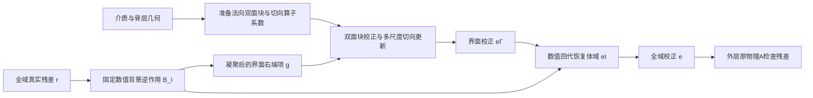

# 候选：骨层双面耦合的界面残差校正

状态：研究设计，未实现/训练/运行。本文公式为候选定义与代数推导；来源事实只在[papers入口](papers/README.md)。C=8、q=4、六级图只用于首版成本估算，不是已验证或已批准实验参数。

## 1. 核心问题与假设

**问题：**在保持完整三维求解精度的条件下，能否减少每次学习校正必须处理的体积自由度，同时保留骨层两侧反射/透射的往返耦合？

事实依据是全域宽特征的存储与运算成本，以及传统界面消元方法的存在。**尚待验证的假设**是：目标介质的困难校正中，有足够大一部分能由两侧界面的耦合表示；软组织体内传播可以由便宜的已有数值步骤承担。不假设McMg失效，也不假设脑内散射可忽略。

## 2. 输入输出与真实算子

沿用同一个合格物理系统 `A u=b`。若基线采用压力/三速度，则每体素d=4个复自由度；不为本方案改成另一物理模型。完整域N=41,287,680。输出仍是最终颅内压力Re/Im形状。

从已有介质标签定位骨层内外表面，取相邻网格自由度构成Γ，其他为I；Γ为原网格索引集合，不重新离散原A。两面靠得很近或骨孔处合并重复索引；无法可靠配对的界面节点保留单面块，不能丢掉。配对、法向和厚度只用于预条件器准备。

将原系统重排为：

`[A_II A_IΓ; A_ΓI A_ΓΓ] [e_I;e_Γ]=[r_I;r_Γ]`。

精确消元的Schur为 `S=A_ΓΓ−A_ΓI A_II⁻¹ A_IΓ`。**这是解释用恒等式，不在实际方案里免费使用精确逆或稠密S。**

B_I定义为固定数值近似：`B_I=R_I Gη E_I`，Gη为与Born基线一致的移位背景逆作用，E/R为零填充/取索引。它仍在完整域执行，首版每次B_I只做一次背景逆作用；不假定它等于A_II⁻¹。若当前物理形式不能直接复用Gη，候选在实现前必须换成明确可应用且匹配基线的B_I，不能隐藏内求解成本。

## 3. 一次预条件作用

给定任意残差r，按以下顺序：

1. `t=B_I r_I`。
2. `g=r_Γ−A_ΓI t`，将体域残差凝聚到界面；源在颅外I中也通过此步进入，不能只读骨面r。
3. `e_Γ=Nθ(m,g)`，网络近似界面校正。
4. `e_I=B_I(r_I−A_IΓ e_Γ)`，数值回代。
5. 重组e，作为FGMRES预条件校正；外层继续用原A更新和检查残差。

若B_I是精确逆且Nθ=S⁻¹，上述公式就是块消元；实际两者都近似，不据此声称收敛保证。数值推导不使用CG的SPD假设。

P45等谱导数底座有非局部作用，几何分域不使A_II自动块对角。A_ΓI和A_IΓ可通过原A的零填充作用取得；由此产生的完整FFT/体域运算全部计时。只把学习特征搬到表面，不代表整个求解成了二维或O(|Γ|)。

## 4. 网络新增的计算结构

Nθ不直接采用标准FNO/GNN替换界面逆。拟采用**法向双面局部消元与切向多尺度耦合的交替更新**：

### 4.1 介质准备

- 对每个可靠配对的内外表面patch，沿法向读取骨层c/ρ/α剖面，建立一维参考列；消去其内部自由度，得到保留两端的局部块D。d=4时两端共8个复自由度。
- D仅是法向参考预条件块，包含内外面交叉项；不是三维真实S，也不替代原A。局部参考列的组装/分解成本属于setup。
- 在两张表面及其配对关系上建立共同层次图。介质网络只读取几何、法向剖面和边参数，生成各级切向权重、提升/投影系数；原始波场和当前残差不参与系数生成。

### 4.2 线性场作用

定义界面近似算子 `Ŝθ = D + Pθ Kθ Rθ`，Rθ把每节点d复分量提升到C个通道，Pθ映回d；二者不预设互为逆。Kθ跨内外两面及切向图作用，含层次传递。固定m和θ时全部对场复线性。

从 `e_Γ⁰=0` 开始，展开q次：

`e_Γ^{k+1}=e_Γ^k + D⁻¹[g−Ŝθ e_Γ^k]`。

D⁻¹通过缓存的小块LU应用，不形成大逆矩阵。近共振的局部块要用阻抗量纲缩放及参考阻尼处理；阻尼强度尚需在最小验证时固定。若D持续病态导致该表示不可用，停止此结构而非声称网络会自动修复。

Kθ不缓存每边C×C矩阵。每层采用 `K_l z_i = W_l Σ_{j∈邻域(i)} a_ij(m)⊙z_j`：每边每通道一个复系数，再用共享C×C矩阵混合通道；跨层用稀疏线性限制/延拓。内面、外面、跨面边分别编码。该因式分解控制缓存，R/P和K的层次作用共享固定介质准备。

残差支路无偏置、无场依赖激活；复权重以Re/Im耦合实现。Nθ(0)=0且Nθ(ig)=iNθ(g)。训练更新θ后重新生成依赖θ的缓存。

### 4.3 新增贡献的准确位置

经典Schur消元、双端口、学习界面、层次图、缓存和复线性都属于已有材料。**拟贡献的是**：把强法向穿层作用交给可计算的双面块，把剩余非可分离切向/跨面作用交给学习算子，并由全域凝聚/回代处理任意分布残差。

这与上一轮体积V-cycle加通量不同，也与只学习Robin边界参数、单外域可分离DtN拟合、ELM输出权重消元不同。若实验显示通用界面网络或经典法向块已经达到相同效果，则本组合没有足够新增贡献，应降级；不以新名字或首次经颅应用维持它。

## 5. 训练与最小验证接口

训练样本可用全域随机复残差r及同一个A构造，不要求新建解标签。基本训练目标为 `||r−A Mθr||²/||r||²`，它是训练手段，不申报为损失创新。必须覆盖体域和两面的驱动；仅在Γ采样会遗漏体域回注问题。

还需记录展开后的界面近似与全域收缩情况，防止只在参考D系统上学好。独立k-Wave形状核查只用于该物理底座的既有评价合同，不把它混为原方程残差。

## 6. 成本及具体风险

令nΓ为两面合计节点数，不是每面数。每次预条件至少两次B_I、两种耦合块作用、q次界面网络以及外层A。速度成立条件是“迭代减少×每步完整成本”确实有利；现阶段没有秒数预测。

成本示例取nΓ=1,000,000、C=8、q=4、六级表面图，每级节点约除4、度数12：

| 对象 | 解析数值/量级 |
| --- | --- |
| 单份C通道表面特征 | 0.0596 GiB |
| 层次边通道缓存，按4/3上界估算 | 0.9537 GiB |
| 8×8双面块LU存储，不含索引/pivot | 0.2384 GiB |
| q次切向算子主要部分 | 约0.8533G complex MAC，另加提升、投影、传递、LU及体域运算 |
| 对照：完整域20复通道的一份特征 | 6.1523 GiB，非McMg实际总显存 |

nΓ尚未测定，示例不代表当前MIDA骨面大小；训练激活、图索引、介质网络和体域四复场另计。真实谱算子耦合可能使两次背景逆/额外A作用主导成本，这是最先淘汰该结构的风险。

**外层基向量不能漏算。**d=4时一份全域状态1.2305 GiB；标准FGMRES重启长度m通常同时保存m+1个V和m个Z，仅这些向量约`(2m+1)×1.2305 GiB`。m=4/8分别为11.0742/20.9180 GiB，另含解、残差、FFT工作区及网络缓存。因此本候选不能依靠长重启来获得虚假的低迭代优势；最小验证须先评估短重启折衷。这里不自动引入分卡或CPU搬运，也不将多张V100显存相加。

## 7. 状态表

| 内容 | 状态 |
| --- | --- |
| 块消元代数、完整A外层检查 | 已有数学基础 |
| 法向参考列和学习切向块的分工 | 本项目候选计算机制 |
| Γ配对、参考阻尼、训练超参数及单卡预算 | 尚待最小验证冻结 |
| 对MIDA的收敛、形状精度和完整速度 | 未运行，尚无结果 |
| 相对所有公开工作的全球首创性 | 本轮只完成定向机制查重，不作此声明 |
