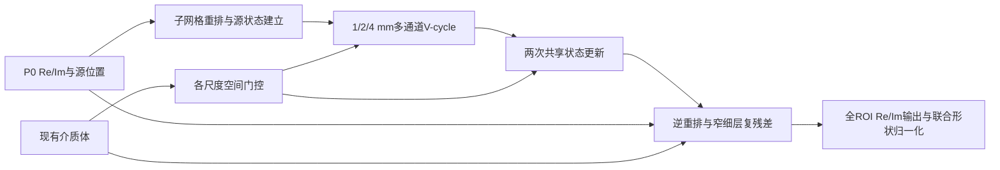

# M0：介质条件、多分量、多尺度的有限状态更新

## 判断、依据、缺口、下一步

- **判断：继续，首选候选；先用两次有限更新，不直接复制二维大网络。**
- **依据：**P32/P33完整复场与变源结果最接近当前目标；其介质生成空间权重再作用于场状态，比仅把源向量塞入瓶颈更直接。P33子集消融同时涉及展开训练，不把22.16%当纯共享结构收益。P27支持多通道粗表示，P44提醒共享参数可能降低精度。当前基线已经有P0与FiLM，创新应落在传播计算与细波保留。
- **缺口：**目标网络未实现/训练；相位保留、乘性介质参与和多次更新三项作用需要分别验证。固定介质结果不等于已获得跨颅骨泛化。
- **下一步：**先过[表示门](../phase_space/VALIDATION.md)，再做[介质交互与更新对照](VALIDATION.md)；完整五卡4 s门是硬筛，不用二维论文计时外推。

## 目标错误与原因假设

目标是基线局部幅相纹理平滑，以及不同未见源场差异恢复不足。假设：源信息主要作为全局条件调制时，源诱导波与介质的多次局部相互作用未被有效表达；压缩又混合不同相位成分。这个假设是待检验的原因，不从视觉平滑直接认定FiLM或U-Net容量有问题。

计算改变有三项：保存块内复波成分；让介质在每层生成作用于场状态的空间权重；用少量多尺度更新交换远近信息。先保留同样P0/介质/源XYZ输入，纯形状损失，不同时引入GDL、物理损失或新Label。

## 对象、尺度与输入

`m`为现有单通道介质张量；`g`为源XYZ；`u0`为当前P0的两通道复表示。[基线ROI hook](../../../../docs/evidence/v10_baseline.md#results)提供这些接口事实。不得以文字设计擅自增加新输入物理量。位置、到源距离/方向可由已知网格和g确定，在需要的位置即时构造，避免复制多份全域坐标。

| 尺度 | 尺寸XYZ | 状态通道 | 用途 |
|---|---|---|---|
| 0.5 mm | 352×352×192 | 窄通路8实通道；输出1复通道 | 局部介质边缘与复细节残差 |
| 1 mm | 176×176×96 | 8复＝16实 | 保存细网格子位置、与输出直接交换 |
| 2 mm | 88×88×48 | 24复＝48实 | 中程混合与多分量传播 |
| 4 mm | 44×44×24 | 48复＝96实 | 低成本长程信息与全域上下文 |

初版采用[phase_space P-A](../phase_space/DESIGN.md)限制/延拓，不同时加方向载波库。固定介质下门控每个空间位置不同，因此对源变化的响应也可不同。保留介质输入为未来跨介质迁移提供路径；固定MIDA实验仅评价这个固定介质映射。

## 介质如何进入一次计算

每尺度由介质编码产生空间门控`c_l=H_l(m_l)`。作用于复状态的局部运算：

`A_l(m,z)=z+c_l(m) ⊙ W_l z`。

`W_l`是共享逐点复通道混合；`c_l`是逐位置逐通道的实门或复门。另用深度3³+逐点混合`K_l`把状态差异映成修正。复门`a+ib`的计算是`(a·Re-b·Im, b·Re+a·Im)`，所以介质能改变幅相组合。空间权重不是每个体素生成一个27×C²卷积核；这种完整动态核在当前域太贵。

第一候选用深度3³+逐点混合，减少密集3D卷积。深度卷积独自不交换通道，逐点复混合承担多分量交互。门控的初始化接近稳定小修正，防止状态初始放大；稳定性仍由真实训练与更新数检查。骨面局部介质编码保留边缘通路，不对所有层只重复同一全局介质向量。

源参与两条路径：P0以空间复场建立初态/各层驱动；XYZ及由它得到的距离方向只作几何补充。1 mm源lift为`pack(u0)+F_l(pack(u0),media8,geometry4)`，保留显式P0残差路径。源条件不是只有瓶颈一个向量。驱动`f_l=F_l(u0,g,m)`在每次更新中保持可访问，避免迭代后源差异被状态覆盖。

## V-cycle与有限更新的具体含义

用学习算子构造一个“状态不一致”`r_l=f_l-A_l(m,z_l)`，先局部修正，再限制r到粗层，粗层修正后延拓回细层，再做局部修正。可以写为：

`z^(t+1)=z^t + V_m(f-A_m z^t), t=0,1`。

这里`A_m/V_m`都是latent运算，r是学习状态差异，**没有称其为真实Helmholtz残差**。训练使用输出形状监督，不要求latent等于物理压力。初始双块建立状态，每个cycle各层前后双块；两次cycle共享权重但保留源驱动，细解码只在最终一次进行。

共享降低参数而不降低重复计算量。先比较T=1/2/3；禁止看到train loss降低就无限追加。若共享使幅相受损，保留两个独立cycle的等预算替代，P44的负向结果使这一步有必要。

若选择严格复线性场算子，固定m且源驱动线性时其内部可保持场线性；加入幅值激活、由源生成门控或最终形状归一化后，整体不再满足简单叠加。当前只要求形状准确，不以“保持线性”作为未经实现核查的承诺。

## 全局覆盖与解码

4 mm层的普通局部卷积在两次cycle中未必覆盖176 mm全域，V-cycle本身不保证全域传播。M0明确采用4 mm轴向低秩混合：每轴`h←h+U_axis(V_axis^T h)`，rank8，沿每条线共享实权重并分别作用于Re/Im；每轴后逐点通道混合。x/y/z依次执行，形成全域依赖；每个cycle执行一轮，已计入成本脚本。

U/V是长度44/44/24的固定位置矩阵，单轴中间rank8不是整场响应rank8。局部介质门控前后夹持这一通路，长程混合不承担独自解释全部传播的任务。全域依赖仅是信息可到达，不等于物理相位传播正确。固定网格上的位置矩阵也不自动具备换分辨率能力。

若主候选通过表示/交互门，再用[空间扫描S0](../spatial_state/DESIGN.md)替换此通路。两者不同时堆叠。M0现在有确定算子选择，尚未实现/运行。

0.5 mm输出为学习复残差与参考场投影的组合，保留小值/强散射区域的加性通路，不强制所有输出都等于`u0×系数`。参考投影幅度按现有输入尺度及训练监督确定；不把未经统一尺度的P0直接与目标单位场相加。最终仅按共同mask进行样本Re/Im联合归一化。

全域窄通路若显存足够是首选；必要时做局部解码调度，各块读取全域粗状态、局部介质/P0与正确坐标，halo覆盖局部卷积感受野。分块拼接使用同一相位约定；不作每块相位对齐/独立归一化。仍重建完整ROI并计全部工作量。

## 三维成本与预期贡献

所有明确卷积、逐点状态差异、两次轴向全域路径、源lift和介质门控均列入[成本脚本](../scripts/cost_model.py)；介质原始输入通道数用C_m保留为公式，详见[COSTS](../COSTS.md)。单份细层8实通道FP16为363 MiB。反向、元素运算、数据搬运与通信待实现实测。不复制OpenBreastUS四A800训练的通道/参数，也不把McMg的45 GB训练示范直接移植V100。

已有部分：P0条件、多网格骨架、动态空间门控、复数运算、子网格重排、共享更新。拟新增部分：在大三维颅骨变源任务中，通过明确的子位置波信息、介质条件状态更新和窄细层解码取得大幅形状改善，并以拆解对照解释改善来自哪里。是否构成有价值的贡献由结果决定。
